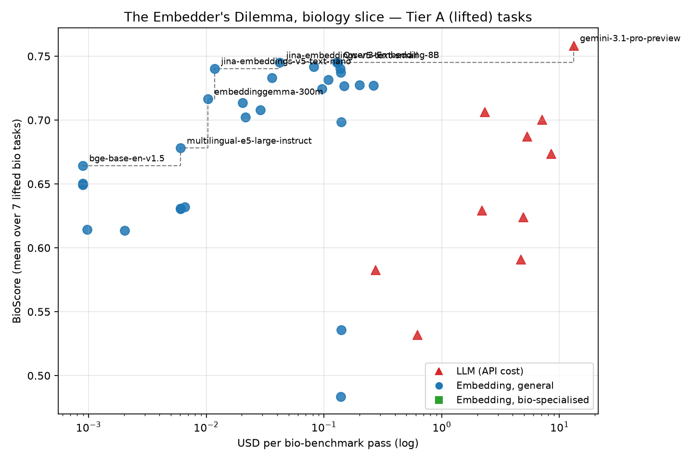

# BioEmbed: The Embedder's Dilemma, for Biology

Recreating the cost-aware LLM-vs-embedding-model comparison of
[*The Embedder's Dilemma: LLMs Are Better, but at What Cost?*](https://arxiv.org/abs/2608.12875)
(El Assadi, Muennighoff, Lee — COLM 2026) on **biological text**.

Question: what does the quality-vs-USD Pareto frontier look like for
biology tasks — open embedders (22M–8B), bio-specialised embedders,
and LLMs prompted directly?

## Findings

Pre-registered claims ([docs/PREREG.md](docs/PREREG.md)), paired tests,
Holm–Bonferroni over the 9 claims run (α = 0.05), on a harness validated by
reproducing the paper's multilingual-e5-small numbers exactly. Full table
with arms and raw p: [results/claims.md](results/claims.md); narrative:
[RESULTS.md](RESULTS.md), [docs/WRITEUP.md](docs/WRITEUP.md).
Main task: rank the ~1,100 PubMed abstracts that mention a gene so the
papers supporting a gene–disease link come first (500 pairs; 493/494 scored;
graded nDCG@10; paired sign-flip). Effect = a − b, 95% paired-bootstrap CI,
not Holm-adjusted.

| claim | a vs b | n | effect [95% CI] | p (Holm) | result |
|---|---|---|---|---|---|
| C5 | our gene–disease fine-tune of bge-base (mean of 3 seeds) vs bge-base off the shelf | 493 | +0.090 [+0.076, +0.104] | 0.0009 | ours better |
| C6 | same fine-tune vs BiCA-base, the best published PubMed-trained model of similar size | 493 | +0.065 [+0.053, +0.078] | 0.0009 | ours better |
| C7 | BiCA-base vs bge-base | 493 | +0.024 [+0.015, +0.034] | 0.0009 | BiCA better |
| C1 | BM25 + bge-base first pass, Gemini 3.1 Flash-Lite rerank of top 20, vs embeddinggemma-300m (best single embedder) | 494 | +0.133 [+0.119, +0.149] | 0.0009 | rerank better |
| C2 | embeddinggemma-300m vs BM25 (tuned on practice set) | 493 | −0.042 [−0.061, −0.022] | 0.0009 | BM25 better |
| C8 | our fine-tuned MedCPT cross-encoder vs the Gemini rerank | 494 | +0.003 [−0.008, +0.014] | 1.0 | no difference shown |
| C3a | small task (300 pairs, hit@1, exact McNemar): Gemini 3.1 Flash-Lite reading all 300 papers vs embeddinggemma-300m | 300 | −0.053 [−0.110, +0.007] | 0.36 | no difference shown |
| C3b | same LLM vs BMRetriever-410M (tied best embedder on practice) | 300 | +0.023 [−0.037, +0.087] | 1.0 | no difference shown |
| C9 | 12-task suite (exact sign-flip over tasks): Gemini 3.1 Pro vs Qwen3-Embedding-8B | 12 | +0.027 [−0.020, +0.081] | 1.0 | no difference shown |
| C4 | is the LLM's edge bigger on pairs it can name the paper for from memory? | — | — | — | dropped |

- **Fine-tuning (C5/C6):** one epoch of bge-base on curated + Europe PMC
  gene–disease pairs (test genes, pairs and papers removed; ~$0.14–0.46 of
  GPU per seed) beats the off-the-shelf model and the best published
  PubMed-trained model of its size.
- **Pipelines (C1/C2):** a cheap first pass plus a reranker beats the best
  single embedder; keyword search beats the best embedder on this haystack.
- **LLM vs embedder (C3/C9):** no difference shown, on the small task or
  the 12-task suite. "No difference shown" does not mean equal.
- **C4 dropped** before its test: the pre-registered rule required at least
  15 test pairs the LLM remembers (names a right PMID or title with no
  papers given); Gemini 3.1 Flash-Lite remembered 9 (PREREG change log,
  2026-10-16).
- C1 and C8 are scored on DeepSeek grades only (Gemini does not grade its
  own rerank), so n = 494 there. Some test scores were seen before rules
  were fixed; all are disclosed in PREREG and WRITEUP §6.



Cost/quality frontier on the 12-task suite (`scripts/pareto_bio.py`):
all embedders plus one frontier LLM at the top, as in the paper.

## The BioMTEB(LLM) suite (12 tasks, 5 categories)

| Tier | Tasks | LLM results |
|---|---|---|
| A — lifted from the paper | BIOSSES, STSBenchmark, Biorxiv/Medrxiv clustering ×3, ToxicConversations, PublicHealthQA | published (free) |
| B — new, from public sources | BioMeSHClassification (30-class), PubChemSynonymPC500, R2MEDBiologyPooled | run (Gemini 3.1 Pro, Gemini 3.1 Flash-Lite, DeepSeek-V4-Flash) |
| C — new, human-curated GAF gold | GOPubMedRetrieval, GOProteinPairCls | run (same three) |

Both paradigms see identical seed-42 data. Tier A uses the paper's public
`mteb/llm-eval-*` subsets; Tier B/C datasets are in `data/tasks/` (committed,
built by `scripts/build_tier_*.py`, adversarially verified).

The gene–disease haystack (500 pairs over 1.7M PubTator-tagged abstracts)
and small task (5 × 75 pairs) used for C1–C8 are separate Tier C tasks with
Open Targets curator gold, not part of the 12-task BioScore
(`scripts/build_tier_c_haystack.py`, `scripts/build_tier_c_gene_disease_v2.py`).

## Layout

- `eval/` — embedding-side runs, pinned `mteb==2.11.6` (the version behind
  the paper's embedding results; harness validated by reproducing their
  multilingual-e5-small numbers exactly).
- `llm/` — LLM-side runs via the paper's `llm_judge` framework (OpenRouter,
  needs `llm/.env` with a key).
- `scripts/` — dataset builders, own-tokenizer token counting
  (`count_tokens_bio.py`), aggregation (`aggregate_bio.py`), Pareto plot
  (`pareto_bio.py`).
- `vendor/embedders-dilemma` — the paper's public repo (clone; gitignored).
- `geometry/` — side project: how much structure the human-gene literature keeps when its
  embeddings are squeezed to a few dimensions for clustering and maps (intrinsic dimension,
  UMAP sweep, t-SNE comparison). Write-up in `geometry/README.md`.
- `results/` — our result JSONs, merged CSVs, figures; `claims.md`/`claims.csv`
  from `scripts/claims.py`.

## Reproduce

```bash
uv sync                                   # analysis env
(cd eval && uv sync && uv run python run_embedders.py --suite all)
uv run python scripts/count_tokens_bio.py
uv run python scripts/aggregate_bio.py
uv run python scripts/pareto_bio.py       # results/figures/bio_pareto.png
```

Cost accounting follows the paper: LLMs at API token prices (cached input
at 10%, generated incl. thinking at output rate); embedders at
own-tokenizer token counts × $/MTok from our own measured throughput on a
spot L4 at $0.48/hr (`results/embedding_throughput_gpu.csv`; all 19 suite
embedders measured, no proxies).

Status: suite, haystack and claims complete (2026-10-17). Open: a human
check of the LLM judges (Dan's 200 blind labels, `labeller/`).
