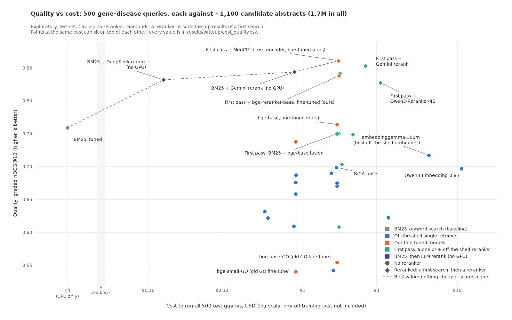

# BioEmbed: finding the papers behind a gene–disease link

*Write-up for Dan, 2026-10-17. Only Table 1's pre-registered claims are
tested; everything else is exploratory.*

## 1. The question

Given a gene and a disease, can a search method rank the papers curators
cite for that link at the top, out of the ~1,100 that mention the gene? At
what cost, and does our training help?

**Words used**

- **BM25:** keyword search; CPU only, so $0.
- **Embedder:** turns text into numbers so similar texts sit close.
- **First pass:** BM25's and bge-base's rank lists merged.
- **Reranker:** re-sorts a first search's top results. *Cross-encoder:*
  reads query and paper together (0.1B–4B parameters; top 100). *LLM
  reranker:* a chat model (top 20).
- **Fine-tune:** extra training of a published model (one **seed** = one run).
- **nDCG@10:** 0–1 score for the top 10; 1 = perfect.
- **p (corrected):** raised (Holm) because we ran 9 tests. Below 0.05 =
  difference shown.

## 2. What we built

**Two answer keys.**

| Key | Right means |
|---|---|
| Curator-only | Cited by Open Targets curators (4 sources). |
| Graded (main) | Two LLMs (Gemini 3.1 Flash-Lite, DeepSeek-V4-Flash) graded every curator-cited paper and every paper in any method's top 10. Ungraded = 0. |

- **2** = evidence for the link; **1** = mentions both, not evidence;
  **0** = neither. A paper gets the judges' mean, rounded down.
- Judges weren't told which papers curators cited; 30% of those (735 of
  2,431) got a 0.
- Curator-only scores are lower (0.3–0.5): good uncited papers count as wrong.
- All grading cost about $8.60.

**Haystack (main test).** 500 gene–disease pairs. Candidates: abstracts
PubTator tags with the gene (median 1,088; 1.7M in all), holding 88% of
curator-cited papers. 493 pairs have a paper graded 1 or 2 and are scored
(494 on DeepSeek grades).

**Small task.** 5 batches of 75 pairs; batch 0 is practice, batches 1–4
(300) are test. Each query ranks the 300 papers in its batch: 1 right, 3
wrong sharing its gene or disease, and the rest. hit@1 = right paper first.

**12-task suite** (C9 only): mixed biomedical tasks, 7 from *The Embedder's
Dilemma*, 5 ours.

**Practice vs test.** Every choice was made on practice sets with other
genes, then run once on test. Claims and tests were committed in
`docs/PREREG.md` before the one look at claim results (2026-10-17); some test
scores came earlier (Caveats).

**Our fine-tunes.** Embedders bge-base and bge-small (3 seeds, within 0.01);
cross-encoders MedCPT and bge-reranker-base (1 seed). Trained on curated plus
Europe PMC text-mined papers (about a third). Test genes, pairs and papers
removed; test diseases with other genes allowed.

<!-- Sources: data/haystack/GeneDiseaseHaystack/manifest.json (median_set 1087.5, recall 0.8771; 1,699,080); qrels.parquet x judgments_merged.parquet (2,431 curator papers: 735 grade 0, 346 grade 1, 1,350 grade 2; 493 qids with a grade >= 1); judgments_merged.parquet (33,531 rows); llm/llm_results/judge/*/*/*.json ($8.59: test $5.83, practice $2.77); data/tasks/GeneDiseaseRetrieval_v2_*/manifest.json; results/bio_scores.csv (source paper 7, ours 5); data/finetune_gd/runs/chosen.json (silver-n3); data/finetune_gd/manifest.json (train_silver: europepmc 11,551 of 34,788 rows; test/practice diseases allowed); docs/PREREG.md; docs/paper/methods.md -->

## 3. Results: the 9 tests (C3 split in two; C4 dropped)

**Table 1.** Confirmatory. Does A beat B? Difference = A − B.

| # | A vs B | Result | Difference [95% range] | p (corrected) |
|---|---|---|---|---|
| C1† | First pass + Gemini rerank vs embeddinggemma-300m (best embedder) | **Rerank better** | +0.133 [+0.119, +0.149] | 0.0009 |
| C2 | embeddinggemma-300m vs tuned BM25 | **BM25 better** | −0.042 [−0.061, −0.022] | 0.0009 |
| C3a‡ | Small task: Gemini 3.1 Flash-Lite (reads all 300) vs embeddinggemma-300m | No difference shown | −0.053 [−0.110, +0.007] | 0.36 |
| C3b‡ | Small task: same LLM vs BMRetriever-410M (tied best) | No difference shown | +0.023 [−0.037, +0.087] | 1.0 |
| C4 | LLM edge bigger on papers it remembers? | Dropped (9 remembered pairs; needed 15) | | |
| C5 | Our fine-tuned bge-base vs bge-base | **Ours better** | +0.090 [+0.076, +0.104] | 0.0009 |
| C6 | Our fine-tuned bge-base vs BiCA-base (best PubMed-trained, same size) | **Ours better** | +0.065 [+0.053, +0.078] | 0.0009 |
| C7 | BiCA-base vs bge-base (general) | **BiCA better** | +0.024 [+0.015, +0.034] | 0.0009 |
| C8† | Our fine-tuned MedCPT cross-encoder vs Gemini rerank (best off the shelf) | No difference shown | +0.003 [−0.008, +0.014] | 1.0 |
| C9‡ | Suite: Gemini 3.1 Pro vs Qwen3-Embedding-8B (expected not) | No difference shown | +0.027 [−0.020, +0.081] | 1.0 |

- Score: graded nDCG@10, hit@1 (small task) or mean task score (suite).
- † DeepSeek grades only (Gemini doesn't grade its own rerank). All systems
  score lower on these (embeddinggemma 0.701, not 0.717).
- ‡ Test numbers seen before the rule was fixed.
- 95% ranges not corrected for 9 tests. 0.0009 is the lowest p possible.
  "No difference shown" does not mean equal.

<!-- Source: results/claims.md and results/claims.csv (mean_a, mean_b, effect, ci_low, ci_high, p_holm, decision, n) -->

## 4. Cost vs quality (exploratory)

- Dashed line: best value (nothing cheaper scores higher). Gaps under ~0.02
  may be noise.

**Table 2.** Key systems. "+" rows re-sort the first pass's top results.

| System | Graded nDCG@10 | Curator-only nDCG@10 | Cost, 500 queries |
|---|---|---|---|
| BM25, tuned | 0.759 | 0.372 | $0 |
| embeddinggemma-300m | 0.717 | 0.430 | $6.55 |
| bge-base | 0.675 | 0.381 | $1.67 |
| bge-base, fine-tuned by us (3 seeds) | 0.764 | 0.400 | $1.67 |
| First pass: BM25 + bge-base | 0.750 | 0.416 | $1.67 |
| + MedCPT cross-encoder | 0.750 | 0.393 | $1.71 |
| + MedCPT cross-encoder, fine-tuned by us | **0.861** | 0.477 | $1.71 |
| + bge-reranker-base, fine-tuned by us | 0.838 | 0.439 | $1.71 |
| + Qwen3-Reranker-4B | 0.827 | 0.489 | $3.19 |
| + Gemini rerank | 0.853 | **0.497** | $2.54 |
| BM25 + Gemini rerank (no GPU) | 0.844 | 0.455 | $0.88 |
| BM25 + DeepSeek rerank (no GPU) | 0.832 | 0.436 | $0.13 |

- Gemini and DeepSeek are also the judges, so their reranks may be
  flattered. Fair test (C8): our MedCPT 0.837, Gemini 0.834.
- Cost = logged GPU hours × $0.94, plus API charges. Embedders pay mostly once
  (embedding 1.7M abstracts); rerankers pay per query. Training ours:
  $0.14–$0.46 each.
- The other 12 off-the-shelf embedders are in
  `results/writeup/cost_quality.csv`; all score below BM25 (graded).

<!-- Source: results/writeup/cost_quality.csv (graded_ndcg10, curator_ndcg10, run_cost_usd, train_cost_usd 0.144-0.455); DeepSeek-only scores: results/writeup/cost_notes.md; figure: docs/writeup_frontier.png, built by scripts/cost_quality.py -->

## 5. What it means (exploratory unless a claim is named)

- **Good rerankers win.** Gemini rerank beat the best embedder by 0.13
  (C1); the top 7 of 46 test runs are reranked. But 4 of 5 off-the-shelf
  cross-encoders were no better than the first pass (2 worse).
- **Fine-tuning helps, most for rerankers.** bge-base gained 0.09 (C5) and
  beat BiCA-base (C6); MedCPT went 0.750 → 0.861, bge-reranker-base
  0.608 → 0.838. On curator-only scores the embedder gain shrinks to +0.02
  (reranker gains hold). Our training negatives were checked against the
  judges' practice grades, which may favour our models.
- **A small fine-tuned reranker did as well as the LLM reranker, as far as
  we can tell** (C8): the gap is probably under 0.015 either way (95% range,
  not corrected; one seed), at $0.04 vs $0.88 per 500 queries.
- **The answer key decides BM25 vs embedders.** BM25 beats all 14
  off-the-shelf embedders on graded scores (C2 tested the best) but trails 7
  on curator-only. Curators may miss papers keyword search finds, or judges
  may favour papers naming the gene and disease (untested).
- **The practice-picked LLM (Gemini) was not shown better than the best
  embedders** (C3a, C3b): 74% right first vs 79%. A third of LLM answers
  listed several papers, often in the given order, so hit@1 partly reflects
  order. Ties broken at random: Gemini 75%, DeepSeek 74% (raw 82%).
- **GO fine-tunes hurt gene–disease search:** 0.12–0.14 below their bases.

<!-- Sources: results/claims.csv; results/haystack/graded/stats.csv (graded_ndcg@10 pooled: top 7 of 46 reranked; ndcg@10 raw); results/writeup/cost_quality.csv (cross-encoders 0.827/0.749/0.750/0.703/0.608 vs first pass 0.750; curator bge-base 0.381 -> 0.400, MedCPT-CE 0.393 -> 0.477; GO 0.675 -> 0.554, 0.658 -> 0.540; step_cost_usd 0.043 vs 0.877); docs/paper/methods.md (negatives "carry the judges' view"); results/llm_v2/summary.csv (test: n_multi 98/89 of 300, hit1_tiebreak 0.752/0.743); results/llm_v2/pairs_test.csv (DeepSeek vs embeddinggemma p 0.44263); results/v2_scores.csv (batches 1-4: bge-base 0.753 vs gaf 0.633; bge-small 0.750 vs gaf 0.607) -->

## 6. Caveats

- **Judges not yet checked against a human.** Dan's 200 blind labels are
  pending, as is his sign-off on the rubric and cut-off (does grade 1 count
  as relevant? nDCG doesn't use it).
- **One first pass.** Its top 100 (cross-encoders) holds 76% of curator-cited
  papers; its top 20 (LLM rerankers) 58%. No cross-encoder ran on BM25 alone.
- **The small task changed.** v2 drops v1's "wrong" papers on related
  diseases (they could be right). In theory easier, yet embedder scores
  barely moved (median −0.015 to −0.03, 24 models; different pairs).
- **Some test scores were seen before the rules were fixed** (all in
  PREREG). No practice pick used test data.
  - Haystack, curator-only: 10 embedders and old BM25 (before draft 1); tuned
    BM25 (C2) and confidence ranges; fusions; BM25 + LLM reranks.
  - Small task: scores printed before a practice tie was settled, so we
    tested both tied embedders (C3a, C3b), not one picked in hindsight.
  - C9's numbers were known before registration.
  - C6/C7 groups, C1 reranker candidates and C8 arms were fixed on
    2026-10-17, after many test runs.
- **Costs are rough.** One GPU price; 10 runs estimated. Rerank and fine-tune
  VMs ran ~7% dearer. BM25 + DeepSeek: ~$0.07 at the later API price. Not
  counted: grading, data building, storage, recipe search (~$3.50).

<!-- Sources: labeller/items_calibration.parquet (200 items), labeller/labels_calibration.sqlite (0 labels); docs/PREREG.md (Waiting on Dan; change log; Starting numbers); docs/paper/methods.md (Disclosures: RESULTS.md by 2026-10-15 16:59; 2d0d111 at 22:37; 540ef36 on 2026-10-17 05:16); results/haystack/graded/stats.csv (recall@100 raw 0.7604); qrels.parquet x runs/rrf-...bge-base (recall@20 0.579); results/writeup/cost_quality.csv (seed_min/seed_max); results/embedding/*/*/GeneDiseaseRetrieval.json vs results/v2_scores.csv (v2 hit@1 minus v1 recall@1 median -0.015, minus v1 precision@1 -0.028; 24 models); results/writeup/cost_notes.md (europe-west3; DeepSeek $0.126 vs $0.074; hs-ft non-test 3.77 h = $3.54) -->

## 7. What's next

1. **Dan's labels:** grade the 200 papers in `labeller/`; sign off rubric and
   cut-off.
2. **Paper:** add results to `docs/paper/methods.md` once judges are checked.
3. **Release:** decide what to share (answer key, scripts, models; not
   abstracts).
