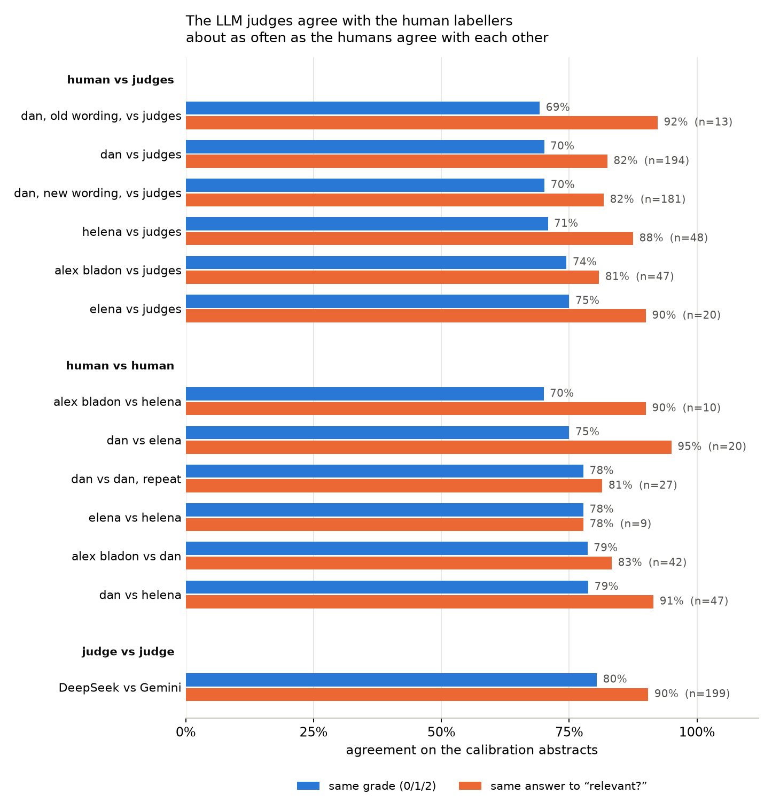

# Results

*Draft, 2026-11-03, from `docs/WRITEUP.md` §3–6. Same conventions as
`methods.md`: each number is followed by an HTML comment naming its source;
`TODO(check)` marks a number not yet reproduced by a committed script. Only
the claims in Table 1 are confirmatory; everything else is exploratory.*

## Confirmatory claims

Nine claims were run (C4 was dropped, below) and corrected together (Holm).
Five differences were shown and four were not (Table 1).

**Table 1.** Pre-registered claims on the test sets. Difference = A − B, with
a 95% paired bootstrap interval (not corrected for multiplicity). The lowest
corrected p possible with 10,000 sign vectors and nine tests is 0.0009.

| Claim | A | B | Score | n | A | B | A − B [95% CI] | p (Holm) | Result |
|---|---|---|---|---|---|---|---|---|---|
| C1†§ | First pass + Gemini 3.1 Flash-Lite rerank | embeddinggemma-300m | haystack nDCG@10 | 494 | 0.834 | 0.701 | +0.133 [+0.119, +0.149] | 0.0009 | A better |
| C2§ | embeddinggemma-300m | BM25, tuned | haystack nDCG@10 | 493 | 0.717 | 0.759 | −0.042 [−0.061, −0.022] | 0.0009 | B better |
| C3a‡ | Gemini 3.1 Flash-Lite, corpus in context | embeddinggemma-300m | small task hit@1 | 300 | 0.740 | 0.793 | −0.053 [−0.110, +0.007] | 0.36 | none shown |
| C3b‡ | Gemini 3.1 Flash-Lite, corpus in context | BMRetriever-410M | small task hit@1 | 300 | 0.740 | 0.717 | +0.023 [−0.037, +0.087] | 1.0 | none shown |
| C5§ | bge-base, fine-tuned (ours, 3 seeds) | bge-base | haystack nDCG@10 | 493 | 0.764 | 0.675 | +0.090 [+0.076, +0.104] | 0.0009 | A better |
| C6§ | bge-base, fine-tuned (ours, 3 seeds) | BiCA-base | haystack nDCG@10 | 493 | 0.764 | 0.699 | +0.065 [+0.053, +0.078] | 0.0009 | A better |
| C7§ | BiCA-base | bge-base | haystack nDCG@10 | 493 | 0.699 | 0.675 | +0.024 [+0.015, +0.034] | 0.0009 | A better |
| C8†§ | First pass + MedCPT cross-encoder, fine-tuned (ours) | First pass + Gemini 3.1 Flash-Lite rerank | haystack nDCG@10 | 494 | 0.837 | 0.834 | +0.003 [−0.008, +0.014] | 1.0 | none shown |
| C9‡ | Gemini 3.1 Pro | Qwen3-Embedding-8B | 12-task suite, mean | 12 | 0.689 | 0.662 | +0.027 [−0.020, +0.081] | 1.0 | none shown |

<!-- results/claims.csv: mean_a, mean_b, effect, ci_low, ci_high, p_holm, decision, n; results/claims.md -->

Haystack scores are graded nDCG@10. † Scored on DeepSeek's grades alone, so
the Gemini rerank is not graded by Gemini; almost every system scores lower on
these grades (all but the two GO fine-tunes; embeddinggemma-300m 0.701, against
0.717 with both judges)
<!-- results/claims.csv: C1 mean_b vs C2 mean_a; results/writeup/cost_notes.md -->.
‡ The claim's own test scores were seen before the rule that uses them was
fixed. § Curator-only (not graded) test scores for some candidate arms were
seen before the candidate sets were registered, and the C8 arms were
registered after many test runs had been made (Disclosures, `methods.md`).
"None shown" (C3a, C3b, C8, C9) does not mean equal: no claim had an
equivalence margin registered.

**C4 dropped.** It asked whether an LLM's edge is larger on pairs whose paper
it can name from memory. Gemini 3.1 Flash-Lite named the paper for 9 test
pairs, below the registered minimum of 15, so the claim was not run and the
correction was recomputed over nine tests
<!-- results/claims.csv: C4 note; docs/PREREG.md: change log 2026-10-16 -->.

**Reranking beats the best embedder (C1).** The cheap first pass (BM25 and
bge-base, fused) reranked by Gemini 3.1 Flash-Lite scored 0.133 above
embeddinggemma-300m, the best off-the-shelf embedder on practice.

**Keyword search beats the best embedder (C2).** Tuned BM25 scored 0.042
above embeddinggemma-300m on the graded key. This depends on the key; see
"The answer key decides BM25 against embedders" below.

**An LLM reading the whole small corpus was not shown better (C3a, C3b).**
On the 300 test queries Gemini 3.1 Flash-Lite put the right paper first for
74.0%, against 79.3% for embeddinggemma-300m and 71.7% for BMRetriever-410M,
the two embedders tied best on practice. Discordant pairs: 31 against 47
(C3a) and 49 against 42 (C3b) <!-- results/claims.csv: C3a, C3b note -->.

**Our fine-tune helps (C5, C6); BiCA-base beats bge-base (C7).** Fine-tuning
bge-base on gene–disease pairs added 0.090 (three seeds, range 0.761–0.767;
C5), and the result beat BiCA-base, the best PubMed-trained embedder of
similar size on practice, by 0.065 (C6). BiCA-base, gte-base fine-tuned with
hard negatives mined from PubMed citation links [@sinha2026bica], in turn
beat bge-base by 0.024 (C7). The two start from different base models, so
C7 does not isolate the effect of PubMed training <!-- results/claims.csv: C5-C7; results/writeup/cost_quality.csv: seed_min 0.7606, seed_max 0.7667; Hugging Face model card bisectgroup/BiCA-base: base_model thenlper/gte-base -->.

**A small fine-tuned reranker was not shown different from the LLM reranker
(C8).** Our fine-tuned MedCPT cross-encoder and the Gemini rerank of the same
first pass differ by +0.003 (95% CI −0.008 to +0.014): the interval excludes
a gap larger than 0.008 in the LLM's favour or 0.014 in ours. C8 tested
superiority only, with no equivalence margin, and the fine-tuned arm has one
seed <!-- results/claims.csv: C8 effect 0.0028, ci_low −0.0076, ci_high 0.0136, decision; model id medcpt-ce-gd-s42 -->.

**An LLM was not shown better than a large embedder on the suite (C9).**
Gemini 3.1 Pro averaged 0.689 over the 12 tasks and Qwen3-Embedding-8B 0.662.
PREREG expected no difference.

## Do the fine-tunes depend on test diseases? (sensitivity check)

Training allowed test and practice diseases when paired with other genes
(Methods, Fine-tuning). We retrained the chosen recipe without them, at
seed 42, and compared each model with its seed-42 original. This check was
registered after the test results were seen, with a rule fixed in advance:
a drop of 0.02 or less in graded nDCG@10 means the gain does not depend on
test diseases (PREREG change log 2026-11-04). The retraining set is also a
third smaller (5,165 curated pairs against 7,574), so a drop would mix the
two causes.

| Model | Score | Without test diseases | Original (seed 42) | Difference [95% CI] |
|---|---|---|---|---|
| bge-base, fine-tuned | graded nDCG@10 | 0.750 | 0.765 | −0.015 [−0.021, −0.008] |
| bge-base, fine-tuned | curator-only nDCG@10 | 0.398 | 0.399 | −0.001 [−0.009, +0.007] |
| MedCPT cross-encoder, fine-tuned | graded nDCG@10 | 0.869 | 0.861 | +0.009 [+0.004, +0.014] |
| MedCPT cross-encoder, fine-tuned | graded, DeepSeek only | 0.847 | 0.836 | +0.011 [+0.006, +0.016] |
| MedCPT cross-encoder, fine-tuned | curator-only nDCG@10 | 0.489 | 0.477 | +0.012 [+0.002, +0.023] |

<!-- results/ntd_readout.csv, .md (scripts/ntd_readout.py): registered rows; 493 pairs graded (494 on DeepSeek's grades), 500 curator-only -->

Scores use the key with the check's 179 new papers (Methods, Graded answer
key), so an original can differ from Confirmatory claims in the third
decimal (the cross-encoder on DeepSeek's grades: 0.836 here, 0.837 in C8).
Paired bootstrap over pairs, 10,000 resamples; no p-values, as registered.

Both models pass the rule. Without test diseases, the embedder lost 0.015 on
graded nDCG@10, more than its seed spread (0.761–0.767), and the interval
reaches just past the 0.02 line. On curator-only nDCG@10 it lost nothing.
It still beat its base by 0.076 and BiCA-base by 0.051, against 0.090 and
0.065 for the three-seed mean in C5 and C6. The cross-encoder did slightly
better without test diseases, on every score. On DeepSeek's grades it led
the Gemini rerank by 0.014 (95% CI +0.003 to +0.025), against 0.003 for the
original in C8. That comparison is descriptive: one seed, no test, outside
the registered family. C8's result stands as registered
<!-- results/ntd_readout.csv: context rows; results/claims.csv: C5, C6, C8; results/writeup/cost_quality.csv: seed_min 0.7606, seed_max 0.7667 -->.

## Cost and quality (exploratory)

<!-- docs/writeup_frontier.png, built by scripts/cost_quality.py -->

**Table 2.** Key test-haystack systems. Graded nDCG@10 over the 493 pairs
with a relevant paper, with a 95% bootstrap interval over pairs; curator-only
nDCG@10 (raw: papers curators did not cite count as non-relevant) over all
500 pairs; cost to run all 500 test queries once.
"+" rows rerank the first pass (cross-encoders its top 100, LLMs its top 20).

| System | Graded nDCG@10 [95% CI] | Curator-only nDCG@10 | Cost (USD) |
|---|---|---|---|
| BM25, tuned | 0.759 [0.738, 0.779] | 0.372 | 0 |
| embeddinggemma-300m | 0.717 [0.696, 0.738] | 0.430 | 6.55 |
| BiCA-base | 0.699 [0.678, 0.720] | 0.382 | 1.65 |
| bge-base | 0.675 [0.653, 0.696] | 0.381 | 1.67 |
| bge-base, fine-tuned (ours, 3 seeds) | 0.764 [seeds 0.761–0.767] | 0.400 | 1.67 + 0.31 training |
| First pass: BM25 + bge-base | 0.750 [0.730, 0.770] | 0.416 | 1.67 |
| + MedCPT cross-encoder | 0.750 [0.733, 0.768] | 0.393 | 1.71 |
| + MedCPT cross-encoder, fine-tuned (ours) | **0.861** [0.847, 0.874] | 0.477 | 1.71 + 0.40 training |
| + bge-reranker-base, fine-tuned (ours) | 0.838 [0.822, 0.853] | 0.439 | 1.71 + 0.46 training |
| + Qwen3-Reranker-4B | 0.827 [0.811, 0.843] | 0.489 | 3.19 |
| + Gemini 3.1 Flash-Lite rerank | 0.853 [0.837, 0.869] | **0.497** | 2.54 |
| + DeepSeek-V4-Flash rerank | 0.841 [0.825, 0.857] | 0.479 | 1.74 |
| BM25 + Gemini 3.1 Flash-Lite rerank (no GPU) | 0.844 [0.827, 0.860] | 0.455 | 0.88 |
| BM25 + DeepSeek-V4-Flash rerank (no GPU) | 0.832 [0.814, 0.849] | 0.436 | 0.13 |

<!-- results/writeup/cost_quality.csv: graded_ndcg10, graded_ci_low/high, seed_min/max, curator_ndcg10, run_cost_usd, train_cost_usd -->

Cost is logged GPU hours at one price ($0.94 per L4-hour) plus API charges;
10 runs without logs are estimated (`results/writeup/cost_notes.md`).
Embedders pay mostly once, to embed the 1.7M candidate abstracts; rerankers
pay per query. The LLM rerankers are also the judges, so their graded scores
may be flattered. Scored on the other judge's grades alone, the Gemini rerank
scores 0.834 (our fine-tuned MedCPT: 0.837 on the same grades) and the
DeepSeek rerank 0.843 (MedCPT: 0.876) <!-- results/writeup/cost_notes.md: other-judge table -->.
The 11 other off-the-shelf embedders all score below BM25 on the graded key
(0.542–0.697) <!-- results/writeup/cost_quality.csv: group single -->.

**Good rerankers win, but not every reranker.** The top seven of 46 test
runs are reranked, led by our fine-tuned MedCPT cross-encoder (0.861)
<!-- results/haystack/graded/stats.csv: graded_ndcg@10, pooled -->.
Yet of five off-the-shelf cross-encoders only Qwen3-Reranker-4B scored above
the first pass (0.827 against 0.750); two were level with it (MedCPT 0.750,
Qwen3-Reranker-0.6B 0.749) and two scored lower (bge-reranker-v2-m3 0.703,
bge-reranker-base 0.608); none of this was tested
<!-- results/writeup/cost_quality.csv: group rerank -->.

**Fine-tuning helps rerankers most.** Our training lifted MedCPT's
cross-encoder from 0.750 to 0.861 and bge-reranker-base from 0.608 to 0.838
(one seed each), for $0.40–0.46 of training each. On the curator-only key
the reranker gains hold (MedCPT 0.393 to 0.477) but the embedder gain shrinks
(bge-base 0.381 to 0.400). Our training negatives were checked against the judges' practice
grades, which may favour our models on the graded key (`methods.md`,
Fine-tuning).

**The cheapest strong system needs no GPU.** BM25 reranked by DeepSeek-V4-Flash
scores 0.832 for about $0.13 per 500 queries (a later DeepSeek rerank of
the first pass, with almost the same tokens, was charged $0.07)
<!-- results/writeup/cost_quality.csv: BM25 + DeepSeek step_cost_usd 0.126; DeepSeek rerank step_cost_usd 0.074; results/writeup/cost_notes.md -->;
our fine-tuned MedCPT reranker scores 0.861 for $1.71, almost all of it the
first pass's embedding (the rerank step itself: $0.04, against $0.88 for
the Gemini rerank of the same first pass)
<!-- results/writeup/cost_quality.csv: step_cost_usd 0.043 vs 0.877 -->.

**Gene Ontology fine-tunes hurt.** bge-base and bge-small fine-tuned on GO
annotation pairs scored 0.554 and 0.540, both about 0.12 below their bases
(0.675, 0.658) <!-- results/writeup/cost_quality.csv: GO rows -->: here,
training on GO annotation pairs did not transfer to gene–disease search.

## The answer key decides BM25 against embedders (exploratory)

On the graded key tuned BM25 scores above all 14 off-the-shelf embedders
(only the best was tested, C2). On the curator-only key it trails seven of
them (embeddinggemma-300m 0.430 against BM25's 0.372) <!-- results/writeup/cost_quality.csv: curator_ndcg10, group single -->.
Curator-only scores are lower for every system (0.25–0.50), since good papers
curators did not cite count as wrong. Two readings fit, and we did not test
between them: curators miss papers keyword search finds, or the judges favour
papers that name both the gene and the disease. C2 is registered on the
graded key, so it stands as a result about that key.

## The small task (exploratory)

A third of the LLM answers listed several papers rather than one (Gemini 98,
DeepSeek 89, of 300), often in the order given, so hit@1 partly measures
order. Breaking such ties at random gives Gemini 75% and DeepSeek 74%; scored as
given, DeepSeek reaches 82% <!-- results/llm_v2/summary.csv: n_multi, hit1_tiebreak, hit1 over batches 1-4 -->.
The small task's v2 drops v1's "wrong" papers on related diseases, since they
could be right. That should make it easier, yet embedder scores barely moved
(median change in hit@1 on test batches 1–4: −0.015 against v1's recall@1,
−0.028 against its precision@1; 24 models, different pairs)
<!-- results/embedding/*/*/GeneDiseaseRetrieval.json vs results/v2_scores.csv -->
TODO(check): not made by a committed script.

## Judges checked against human graders (exploratory)

One author (D.B.) graded 200 calibration abstracts with the judges' 0/1/2
scale, and three colleagues graded subsets <!-- labeller/items_calibration.parquet; labeller/labels_calibration.sqlite -->.
Over all 194 of D.B.'s gradeable labels the judges match 70% exactly.
Colleagues match D.B. on 75–79% (Table 3), but on different, smaller sets
(20–47 labels), so the two are not like-for-like. On the 91 abstracts D.B.
and a colleague both graded, the judges agreed with him about as often as the
colleague did, but they grade lower (below)
<!-- results/figures/judge_agreement.csv: dan vs judges n 194 exact 0.701; human vs human dan pairs n 20–47 exact 0.75–0.79 -->.

**Table 3.** Agreement on the calibration abstracts. Exact = same grade;
relevant = same answer to "grade ≥ 1?"; grade 2 = same answer to "grade = 2?".
Unsure labels and one unblinded item are left out.

| Comparison | n | Exact | Relevant | Grade 2 |
|---|---|---|---|---|
| D.B. vs judges (merged grade) | 194 | 70% | 82% | 84% |
| Colleagues vs judges (three people) | 20–48 | 71–75% | 81–90% | 79–94% |
| D.B. vs colleagues (three people) | 20–47 | 75–79% | 83–95% | 80–93% |
| D.B. vs D.B., repeat | 27 | 78% | 81% | 96% |
| DeepSeek vs Gemini | 199 | 80% | 90% | 86% |

<!-- results/figures/judge_agreement.csv, scripts/judge_agreement.py; exclusion: PREREG 2026-10-19 12:31 -->

On the 91 abstracts D.B. and a colleague both graded (109 abstract–colleague
pairs; an abstract graded by two colleagues counts twice for both sides), the
colleague matched D.B.'s grade on 78% and the judges on 80% (difference +2
points, 95% bootstrap over abstracts −8 to +12); on "relevant?" 89% against
88%; on grade 2, 86% against 91%
<!-- results/figures/judge_agreement_overlap.csv: analysis overlap; scripts/judge_agreement.py, 10,000 resamples, seed 0 -->.

The judges grade lower than D.B. Where they differ from his 194 labels they
are lower 44 times and higher 14, mostly his 2 as their 1 and his 1 as their
0 (18 and 19 of the 44)
<!-- results/figures/judge_agreement_overlap.csv: analysis direction; scripts/judge_agreement.py -->.
The human guide counts cell models as evidence (grade 2), and the judges'
rubric does not (PREREG 2026-10-19 14:32). A registered check (PREREG
2026-11-03) resent the same 184 abstracts to the judges with the human
guide's wording: agreement with D.B. moved from 70% (42 lower, 13 higher) to
71% (38 lower, 15 higher) <!-- results/judge_wording_check.csv: arm same vs human, judge judges -->.
DeepSeek moved most (exact agreement 69% to 72%; 44 to 33 lower)
<!-- results/judge_wording_check.csv: arm same vs human, judge deepseek -->.
The wording explains little of the gap. The gap is mostly DeepSeek's: its
mean grade is 0.95 against D.B.'s 1.16 and Gemini's 1.15, and the merged
grade rounds down
<!-- results/judge_wording_check.csv: arm same, mean_grade, dan_mean -->.
So graded scores are, if anything, strict; the answer key stands as judged.
