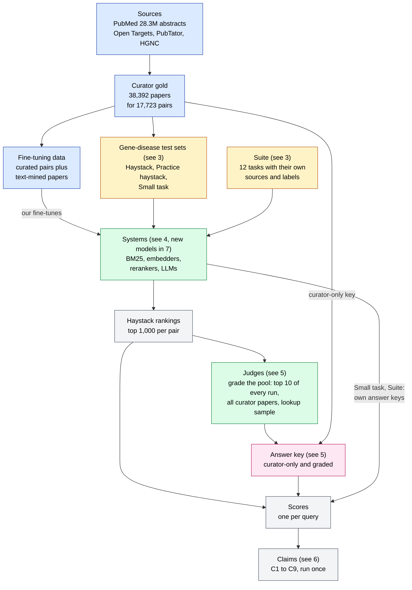
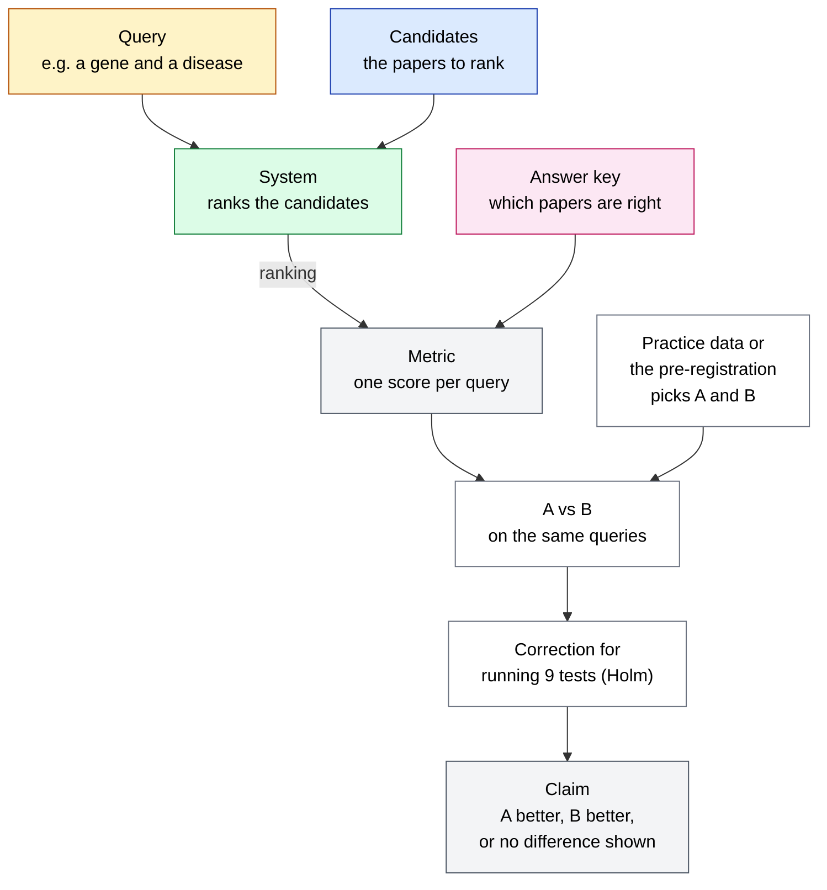
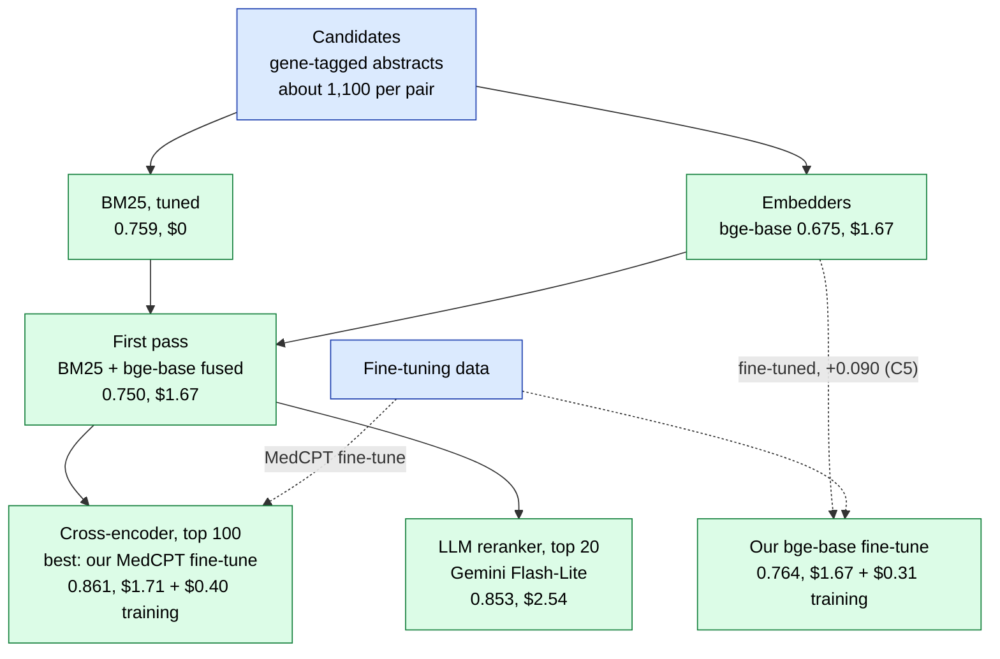
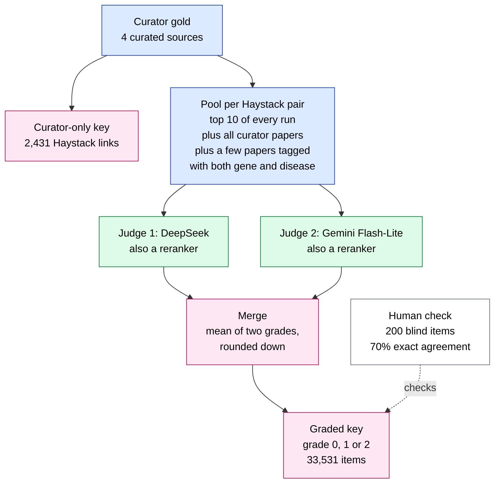
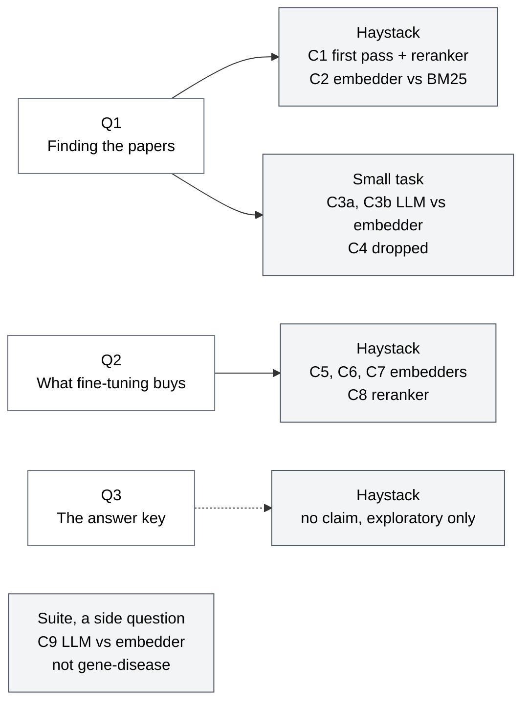
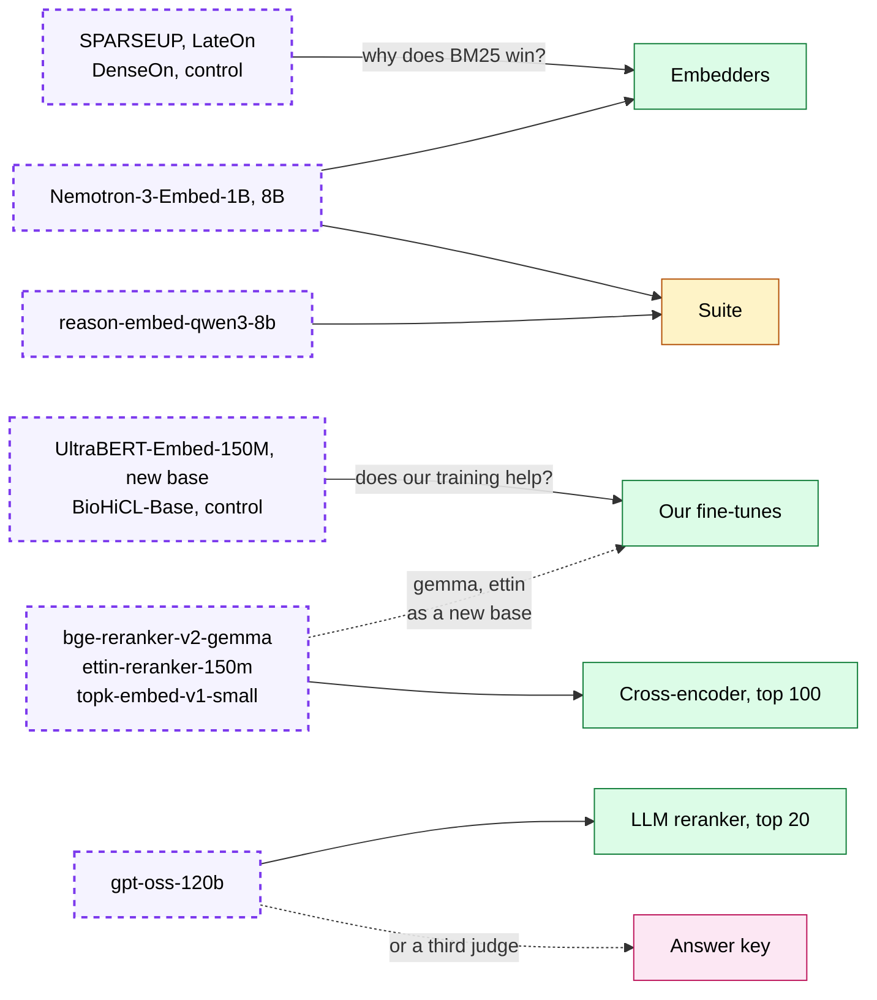

# How Paper 1 fits together

A short map of BioEmbed Paper 1: what flows where, and where the new ideas plug in.
Every number here comes from the docs listed at the end. Where this guide infers something, it says "(inferred)".

## 1. The paper in one paragraph

Paper 1 asks one question. Given a gene and a disease, can a search method put the papers curators cite for that
link at the top, out of the ~1,100 abstracts that mention the gene? It also asks what that costs, and whether our
training helps. The pre-registration splits this into three questions. Here is the answer to each in one line.

- Q1, finding the papers. A cheap first pass plus a good reranker beats the best single embedder (C1). Tuned BM25
  beats the best embedder (C2). An LLM reading a whole small corpus was not shown different from embedders
  (C3a, C3b). Not shown different is not the same as equal.
- Q2, what fine-tuning buys. Our bge-base fine-tune lifts bge-base by +0.090 (C5). Our MedCPT fine-tune was not
  shown different from the Gemini Flash-Lite rerank (C8), and its rerank step costs $0.04 instead of $0.88.
- Q3, the answer key. No claim tests it, but the key decides BM25 against embedders, and nobody has yet estimated
  how much curators miss.

C9 sits outside these three. It asks whether the Embedder's Dilemma result holds on biology text.

Names used in this guide:

| Name | What it is |
|---|---|
| Haystack | The main test. 500 gene-disease pairs, each with every abstract PubTator tags with the gene. |
| Practice haystack | 200 other pairs with other genes. The BM25 settings, the fine-tune recipe and every Haystack "best" are picked here. |
| Small task | 300 pairs in 4 batches. An LLM reads all 300 abstracts of a batch and lists the ones that help. |
| Suite | 12 mixed biology tasks with their own sources and labels. Used only for C9. |
| Curator gold | The papers four curated Open Targets sources cite for each pair. |
| Answer key | Which papers count as right. Two kinds: the curator-only key and the graded key. |
| Judges | Two LLMs, DeepSeek (Judge 1) and Gemini Flash-Lite (Judge 2), that grade papers 0, 1 or 2. |
| DeepSeek | DeepSeek-V4-Flash. Judge 1, and the no-GPU reranker of BM25. |
| Gemini Flash-Lite | Gemini 3.1 Flash-Lite. Judge 2, the LLM reranker in C1 and C8, and the LLM in C3. |
| Gemini Pro | Gemini 3.1 Pro. The LLM in C9 only. |
| First pass | BM25 and bge-base rank lists, fused. Rerankers re-sort its top results. |
| Our fine-tunes | Our bge-base fine-tune (an embedder, 3 seeds) and our MedCPT fine-tune (a cross-encoder, 1 seed). |

Terms used in this guide:

| Term | Meaning |
|---|---|
| BM25 | Keyword search. A paper scores higher for each query word it shares, and rare words count more. |
| Embedder | A model that turns the query and each paper into a vector, then ranks papers by closeness. |
| Cross-encoder | A model that reads the query and one paper together and scores the pair. Slow, so it reranks a top list. |
| LLM reranker | An LLM given the query and the top 20 papers, asked to re-sort them. |
| Fused | Two rank lists merged into one. |
| nDCG@10 | 0 to 1. How near the top of the first 10 the right papers sit. Graded: a 2 counts twice a 1. |
| hit@1 | Whether the right paper is ranked first. |
| recall@100 | The share of right papers found in the top 100. |
| Paired test (sign-flip, McNemar) | A and B are scored on the same queries, and only their differences count. |
| Holm | A correction for running 9 tests, so one lucky result does not count as a finding. |
| Spearman, V-measure, accuracy, max AP, recall@1 | Each Suite task's usual score. Higher is better. |

Scores are graded nDCG@10 on the Haystack, from 0 to 1, unless a line says otherwise.
Costs are for running all 500 Haystack queries once.

## 2. The whole paper on one page

Colours mean the same in every diagram:

- Blue: data.
- Yellow: a test set.
- Green: a system, a model or search that ranks or grades papers.
- Pink: the answer key.
- Grey: rankings, scores and claims.
- White: a question or a step.
- Dashed purple: a new idea.

Three links are left out of the diagram to keep it readable. The fine-tuning data also takes Europe PMC text-mined
papers from the sources. Every test gene, pair and paper is removed from it. And our training negatives were checked
against the judges' practice grades.

The judges grade only the Haystack and the Practice haystack. The Small task scores against each pair's one curated
paper, and the Suite against each task's own labels.

The claims ran once, on 2026-10-17 at 10:36. The script refuses to run while any claim lacks an arm, so that one run
is the one look.

## 3. The moving parts every test shares

This zooms into the two test-set boxes.

Every test has the same shape. A query and its candidates go into a system. The system's ranking is scored against
an answer key. Two systems, A and B, are compared on the same queries. That gives a claim.
Most arms are picked on practice data. Both C9 arms, and C5's bge-base (the fine-tune's base), were named in the
pre-registration instead.

The main tests. The three gene-disease tests share one query: gene symbol, gene name and disease name.

| Test | Size | Answer key | Metric | Claims |
|---|---|---|---|---|
| Haystack | 500 pairs, 473 genes. Every local abstract PubTator tags with the gene: median 1,087.5 per pair, 1.7M in all. | Graded key, the main one. Curator-only key also shown. | Graded nDCG@10. Paired sign-flip test. | C1, C2, C5, C6, C7, C8 |
| Practice haystack | 200 pairs, no shared genes. Median 816 abstracts per pair. Genes tagged in over 20,000 abstracts left out. | Curator gold, plus a graded practice key of 12,417 items. | Depends on the pick: curator-only nDCG@10 or recall@100, or graded nDCG@10. | None. It makes the picks for C1, C2, C5 to C8. |
| Small task | 300 pairs in 4 batches of 75, only pairs with one curated paper. All 300 abstracts of the batch: per query its gold, 2 same-gene and 1 same-disease decoys. | The pair's one curated paper. No LLM grading. | hit@1. Exact McNemar test. | C3a, C3b. C4 dropped. |
| Small task practice batch | Batch 0: 75 pairs, 300 abstracts. | One curated paper per pair. | hit@1, as a count of 75. | None. Picks for C3a, C3b. |
| Suite | 12 tasks. Retrieval corpora pooled so an LLM can read them. | Each task's own labels. | Mean of 12 task scores. Exact sign-flip over tasks. | C9 |

Why each test exists. Each line says what only this test can answer.

- Haystack. The real search task, the filter-then-rank setup curation pipelines use. Too big for an LLM to read, so
  it tests first pass plus reranker.
- Practice haystack. A practice exam. Its genes and pairs are never trained on. The BM25 settings, the fine-tune
  recipe and every Haystack "best" are picked here, then run once on the Haystack. Rerank depths, model instructions
  and the fine-tune checkpoint were fixed in advance, not tuned. Ten dense test runs were made before any practice
  dense run (methods.md, Disclosures).
- Small task. The only gene-disease test small enough for an LLM to read every abstract. The LLM lists the abstracts
  that help, and hit@1 scores the first one listed. A third of LLM answers listed several, mostly in prompt order,
  so hit@1 partly reflects document order.
- Small task practice batch. Picks the best LLM and the best embedder for C3.
- Suite. Repeats the Embedder's Dilemma LLM vs embedder test on biology text. Not about gene-disease search.

Side checks. None of these is a claim.

| Check | Size | Why it exists | Outcome |
|---|---|---|---|
| Old small task, v1 | 75 pairs, 300 abstracts | Its decoy guard covered only the exact pair, so a "wrong" paper could be right. Kept to see if the fix moved embedder scores. | Appendix only. Median change -0.015 at recall@1 and -0.028 at precision@1, over 24 models. Not from a committed script yet. |
| Clean-gold key | 1,916 of 2,431 Haystack golds | A stricter curator key, as a check. | Not reported yet. |
| Human check | 200 blind Haystack items plus 30 repeats; colleagues graded 120 | Tests the judges against people. | D.B. vs judges 70% exact. Judges grade lower. |
| Judge wording check | 184 human-check abstracts, re-sent to both judges with the human guide's wording | Do the judges grade lower than people because of the rubric's wording? | Agreement with D.B. moved from 70% to 71%. The wording explains little. The gap is mostly DeepSeek's. |
| No-test-disease fine-tunes | Our bge-base and MedCPT fine-tunes retrained at seed 42 with no test or practice diseases | Does our training's gain depend on seeing test diseases? Registered after the test results were seen. | Both pass the 0.02 rule. bge-base lost 0.015 [-0.021, -0.008], so the interval reaches past the line; on the curator-only key it lost nothing. MedCPT gained 0.009. Its two runs added the 179 items in section 5. |
| Memory probe | Each LLM names papers for a pair, given no abstracts | Labels the pairs an LLM remembers, for C4. | Gemini Flash-Lite remembers 9 pairs, C4 needed 15, so C4 was dropped. |
| Probe re-check | The 13 probe replies that did not stop, re-sent once at temperature 1 | Would Gemini Flash-Lite's memorised count move? | 12 of 13 stopped. None was scored memorised, so the count stays at 9 and C4 stays dropped. |
| Fine-tune validation split | 160 genes, 1,366 rows | Watches eval loss during training (inferred). No checkpoint is picked on it. | Not a test. |

The 12 Suite tasks. All of them feed only C9. Seven come from the Embedder's Dilemma, five are ours.

| Task | Kind | Size | Answer key | Metric | Why it exists |
|---|---|---|---|---|---|
| LLMBIOSSES | Similarity, Dilemma | 100 sentence pairs | Human similarity scores | Spearman | The biomedical similarity task. LLM results are free from the Dilemma. |
| LLMSTSBenchmark | Similarity, Dilemma | 500 sentence pairs | Human similarity scores | Spearman | A general-text anchor. Shows how biology differs from general text (inferred). |
| LLMBiorxivClusteringP2PV2 | Clustering, Dilemma | 1k abstracts | bioRxiv category | V-measure | A biomedical Dilemma task. Clustering is where LLMs fail worst on bio text. |
| LLMMedrxivClusteringP2PV2 | Clustering, Dilemma | 1k abstracts | medRxiv category | V-measure | A biomedical Dilemma task. Varies the source (inferred). |
| LLMMedrxivClusteringS2SV2 | Clustering, Dilemma | 1k titles | medRxiv category | V-measure | Titles only, so clustering with very little text (inferred). |
| LLMToxicConversationsClassification | Classification, Dilemma | 500, 2 classes | Toxicity labels | Accuracy | A general binary anchor. A contrast to the 30-class BioMeSH task (inferred). |
| LLMPublicHealthQA | Retrieval, Dilemma | 100 questions, 172 answers | The matching answer | recall@1 | The only Dilemma retrieval task, health domain (inferred). |
| BioMeSHClassification | Classification, ours | 500 test, 30 classes | MeSH descriptor | Accuracy | Many-class biology, the analogue of the Dilemma's biggest embedder win. LLMs won here instead. |
| PubChemSynonymPC500 | Pair classification, ours | 500 pairs, 50 synonyms | PubChem synonym labels | max AP | Chemical name variants. |
| R2MEDBiologyPooled | Retrieval, ours | 100 questions, 363 docs | R2MED judgements | recall@1 | Reasoning-heavy retrieval, where the Dilemma found LLMs lead. |
| GOPubMedRetrieval | Retrieval, ours | 75 GO terms, 300 abstracts | Papers GO curators cite | recall@1 | Curator-cited papers as the key, like the Haystack, but for GO terms (inferred link). |
| GOProteinPairCls | Pair classification, ours | 500 pairs, half positive | Curated GO annotations | max AP | Matches protein function text to a GO term, often with no shared words (inferred). |

## 4. The systems ladder

This zooms into the Systems box.

Each rung builds on the one before. Cheap searches make a first pass, and rerankers re-sort its top results.
Our fine-tunes plug in as an embedder and as a cross-encoder.

| System | Graded nDCG@10 | Cost per 500 queries |
|---|---|---|
| BM25, tuned | 0.759 | $0 |
| embeddinggemma-300m, best off-the-shelf embedder | 0.717 | $6.55 |
| bge-base | 0.675 | $1.67 |
| Our bge-base fine-tune, 3 seeds | 0.764 | $1.67 plus $0.31 training |
| First pass, BM25 + bge-base | 0.750 | $1.67 |
| First pass + Qwen3-Reranker-4B | 0.827 | $3.19 |
| First pass + our MedCPT fine-tune | 0.861, best of 46 runs | $1.71 plus $0.40 training |
| First pass + Gemini Flash-Lite rerank | 0.853 | $2.54 |
| BM25 + DeepSeek rerank, no GPU | 0.832 | $0.13 |

Things to keep in mind.

- The LLM rerankers are also the judges, so their graded scores may be flattered. On DeepSeek's grades alone,
  the Gemini Flash-Lite rerank scores 0.834 and our MedCPT fine-tune 0.837.
- Our training negatives were checked against the judges' practice grades, which may favour our fine-tunes on the
  graded key.
- Only one of five off-the-shelf cross-encoders, Qwen3-Reranker-4B, beat the first pass.
- The gene filter keeps 87.7% of curator papers per pair. The first pass's top 100 holds 76% of them, and its top 20
  holds 58%. No reranker can find what is not there.
- A $0 PubTator lookup, abstracts tagged with both gene and disease, is a baseline that does not rank.
  It is not reported yet.
- Cost is exploratory. GPU time is priced at $0.94 per L4-hour. LLM judging, data building and the fine-tune recipe
  search ($3.54) are not counted.

## 5. How the answer key is made

This zooms into the Judges and Answer key boxes.

There are two keys. The curator-only key is free but misses papers. The graded key is the main one.

- The rubric. 2 means the abstract is evidence that this gene is involved in this disease. 1 means it discusses both,
  but is not evidence for the link. 0 means neither.
- The judges never see rank, system, or whether curators cited the paper. Unjudged papers count as 0.
- Curator-cited papers are graded like any other. The judges graded 735 of 2,431 of them 0. That is 30%.
- No self-grading. C1 and C8 include a Gemini Flash-Lite rerank, so both sides of each are scored on DeepSeek's
  grades only.
- The curator-only key comes in two forms. Raw counts Europe PMC text-mined papers as wrong. Condensed drops them.
- New runs get graded under an add-later rule. On 2026-11-04 the no-test-disease check's two runs added 179 items
  for $0.24 and moved no claim.
- Grading the Haystack and the Practice haystack cost about $8.59 in all.
- The judges grade lower than D.B., mostly because of DeepSeek, and the merge rounds down. So graded scores are,
  if anything, strict.
- Q3 asked how much curators miss. The lookup sample in the pool is weighted so it could answer that. The estimator
  was never registered and the estimate was never made.

## 6. Which claim tests what

This zooms into the Claims box.

The pre-registration does not map claims to questions. This mapping is read from the claim wording.
C9 is drawn on its own: it asks whether the Embedder's Dilemma holds on biology text, which none of Q1 to Q3 covers.

| Claim | A vs B | Test | Result |
|---|---|---|---|
| C1 | First pass + Gemini Flash-Lite rerank vs embeddinggemma-300m | Haystack, DeepSeek grades only | 0.834 vs 0.701, +0.133. A better. |
| C2 | embeddinggemma-300m vs BM25, tuned | Haystack | 0.717 vs 0.759, -0.042. BM25 better. |
| C3a | Gemini Flash-Lite reading the whole batch vs embeddinggemma-300m | Small task | 0.740 vs 0.793 hit@1. No difference shown. |
| C3b | Gemini Flash-Lite reading the whole batch vs BMRetriever-410M | Small task | 0.740 vs 0.717 hit@1. No difference shown. |
| C4 | LLM edge on pairs it remembers | Small task | Dropped. Only 9 remembered pairs, 15 needed. |
| C5 | Our bge-base fine-tune vs bge-base | Haystack | 0.764 vs 0.675, +0.090. A better. |
| C6 | Our bge-base fine-tune vs BiCA-base | Haystack | 0.764 vs 0.699, +0.065. A better. |
| C7 | BiCA-base vs bge-base | Haystack | 0.699 vs 0.675, +0.024. A better, but the two start from different base models. |
| C8 | Our MedCPT fine-tune vs Gemini Flash-Lite rerank | Haystack, DeepSeek grades only | 0.837 vs 0.834, +0.003. No difference shown, which is not the same as equal. |
| C9 | Gemini Pro vs Qwen3-Embedding-8B | Suite | 0.689 vs 0.662, +0.027. No difference shown, as expected. |

All five differences shown have a Holm p of 0.0009, the lowest possible with 9 tests.
No claim had an equivalence margin, so "no difference shown" never means "equal".

One exploratory result matters for C2. On the curator-only key BM25 trails 7 of the 14 off-the-shelf embedders,
and embeddinggemma-300m scores 0.430 against BM25's 0.372. C2 is registered on the graded key, so it stands as a
result about that key.

## 7. Where the new ideas plug in

This adds to the Systems box.

These are the models in the [Hugging Face survey's first-try list](hf-model-survey.md#what-to-try-first).
None of them changes a claim, because C1 to C9 are closed. Each would add an exploratory row.

| Model | Plugs into | Kind | What it would tell us |
|---|---|---|---|
| Nemotron-3-Embed-1B | Embedders, and the Suite | New system | A bigger modern embedder on the full Haystack. About 14 L4-hours (survey notes, hf-model-survey.json). |
| Nemotron-3-Embed-8B | Embedders, and the Suite | New system | The best open single-vector health retriever, against Qwen3-Embedding-8B. The full Haystack would take about 64 L4-hours (survey notes). Using it only at rerank depth is an option (inferred from methods.md: "bigger models are left to reranking"). |
| SPARSEUP | Embedders | New system | Learned sparse search. Shows which words drive a match. Needs a sparse scoring path. |
| LateOn | Embedders, or reranks BM25's top 100 | New system | Late interaction. Shows whether the gene symbol or the disease word drives a match. Needs a MaxSim path. |
| DenseOn | Embedders | Control | Same backbone and data as SPARSEUP and LateOn, so only the architecture changes. |
| UltraBERT-Embed-150M | Our fine-tunes, as a new base; plus its own Haystack run | New system | Does the C5 gain stack on a better base? Needs 3 seeds to match C5. |
| BioHiCL-Base | Our fine-tunes, as a control (run as an embedder) | Control | bge-base plus MeSH training vs our bge-base fine-tune. The same-base control C6 lacks, since BiCA-base is built on gte-base. |
| bge-reranker-v2-gemma | Cross-encoder, top 100; later a LoRA base for our fine-tunes | New system | An open reranker against our 0.861. Needs a yes-logit scorer. |
| ettin-reranker-150m | Cross-encoder, top 100; a new base for our fine-tunes | New system | A better base than MedCPT? On CPU it could rerank BM25's top 100 with no GPU. |
| topk-embed-v1-small | Cross-encoder slot, top 100 | New system | The health-retrieval leader. Too big for a first pass. |
| gpt-oss-120b | LLM reranker, top 20; or a third judge | New system, or answer-key check | A rerank neither judge made, so both judges can grade it. It cannot turn reasoning off. Check Vertex AI first. |
| reason-embed-qwen3-8b | Suite, R2MED slot | New system | The R2MED leader. Check its training data against BRIGHT first (survey, finding 1). |
| harrier-oss-v1-270m | genesearch | Other thread | May replace MedEmbed-small in genesearch. A Haystack run would only be a test bed. |
| hunflair2-ner | Gene-tag audit | Other thread | A second-opinion gene tagger. It does not change the Haystack's 87.7% ceiling. |

Rules for any new Haystack run. Run it on the Practice haystack first. Then grade its top 10 under the add-later rule.

Nemotron-3-Embed's R2MED score may be inflated. The survey says it was trained on data seeded from BRIGHT, and
R2MED Biology is BRIGHT Biology.

## 8. Where to read more

- The question and the words used: [WRITEUP.md, section 1](WRITEUP.md#1-the-question).
- The three questions, test sets, rules and change log: [PREREG.md](PREREG.md#the-three-questions).
- Sources and curator gold: [methods.md, Data sources](paper/methods.md#data-sources) and
  [Gold standard](paper/methods.md#gold-standard).
- How each test set is built: [methods.md, Test sets](paper/methods.md#test-sets).
- The graded key and the human check: [methods.md, Graded answer key](paper/methods.md#graded-answer-key).
- Every system: [methods.md, Systems](paper/methods.md#systems). Fine-tuning:
  [methods.md, Fine-tuning](paper/methods.md#fine-tuning).
- What was picked on practice data, and why: [selections.md](paper/selections.md).
- Cost: [methods.md, Cost model](paper/methods.md#cost-model).
- Tests and statistics: [methods.md, Metrics and statistics](paper/methods.md#metrics-and-statistics).
- Claim results: [results.md, Confirmatory claims](paper/results.md#confirmatory-claims) and
  [claims.csv](../results/claims.csv).
- The no-test-disease check:
  [results.md](paper/results.md#do-the-fine-tunes-depend-on-test-diseases-sensitivity-check).
- Cost against quality: [results.md, Cost and quality](paper/results.md#cost-and-quality-exploratory).
- The key decides BM25 against embedders:
  [results.md](paper/results.md#the-answer-key-decides-bm25-against-embedders-exploratory).
- Judges against people: [results.md](paper/results.md#judges-checked-against-human-graders-exploratory).
- The Suite: [README.md](../README.md), [suite.py](../src/bioembed/suite.py) and
  [aggregate_bio.py](../scripts/aggregate_bio.py), which defines the 12.
- New models: [hf-model-survey.md](hf-model-survey.md#what-to-try-first), with cost notes in
  [hf-model-survey.json](hf-model-survey.json).
- [DESIGN.md](DESIGN.md) is the old plan. Many of its tasks were dropped. Trust it only where newer docs agree.

Where the docs disagree. This guide follows methods.md and claims.csv.

- claims.csv, claims_config.yaml and PREREG say the Small task LLM reads "4 papers". As built, it reads all 300
  abstracts of its batch, and hit@1 is over 300.
- PREREG's "How we score" says guessing scores 0.25 on the Small task. Its own change log (2026-10-15) and
  methods.md say chance is 1 in 300, or 1 in 4 for a method that already knows the gene and disease.
- suite.py says embedders classify by kNN. The installed mteb uses logistic regression with 8 examples per label.
- suite.py says R2MED is pooled to about 300 docs with decoys. The built task has 363 docs, all gold.
- suite.py still lists the two small gene-disease tasks under Tier C, but they are not among the 12 Suite tasks.
- WRITEUP's cost table gives the bge-base fine-tune's run cost only ($1.67), and lists training apart as
  $0.14-$0.46 per model. results.md puts $1.67 plus $0.31 training on one line. This guide does the same.
- methods.md says Qwen3-Embedding-8B would need about 900 L4-hours on the Haystack. The survey notes, at
  Qwen3-Embedding-8B's measured speed, put an 8B model at about 64 L4-hours for the same 1.7M abstracts. Not settled.
