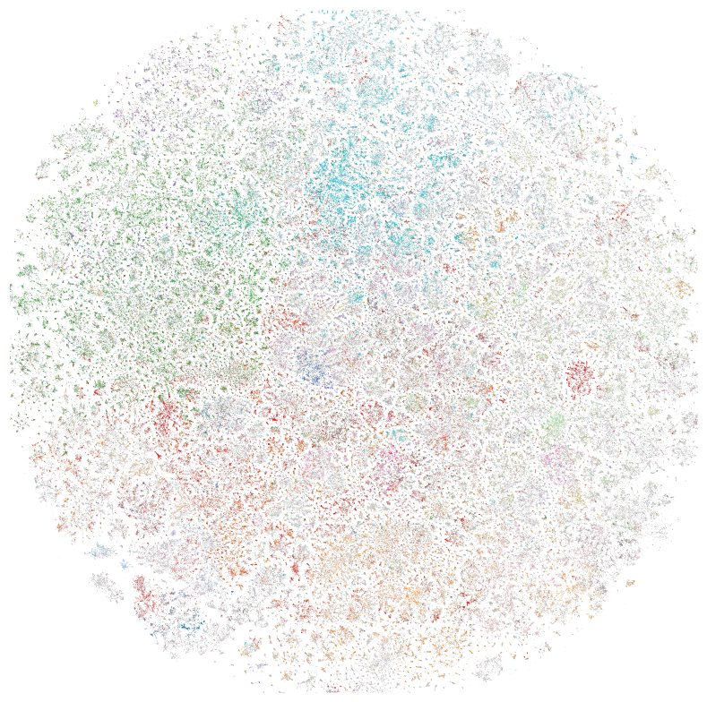
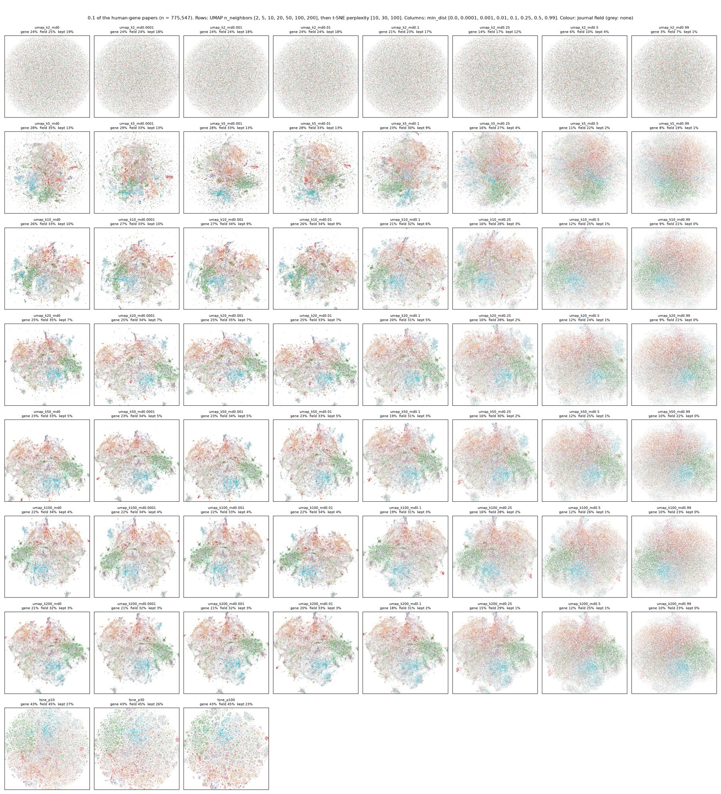
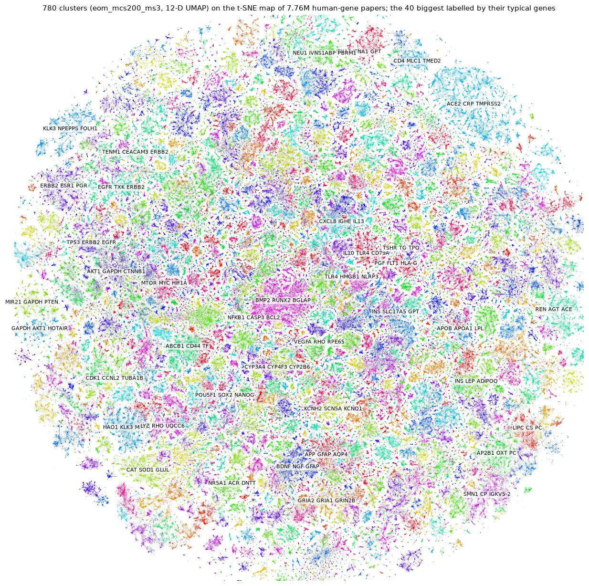

# geometry: the shape of the human-gene literature

The long-run question: what does "the geometry of biological knowledge" look like, and how does it change
from one embedding model to another? The first steps, below, use one model (MedEmbed-small) on the papers
about human genes, and ask a narrower question first: **when we squeeze the embeddings down to a few
dimensions to cluster and draw them, how much of their structure survives?**

Started 2026-10-28. Status: dimension reduction, drawing and clustering tuned (2026-11-02); one model so far.

## Everything we tried, at a glance

All on the 7.76M human-gene papers (MedEmbed-small, 384-D) unless a subset is named. "Share a gene": of a paper's
15 nearest neighbours, the share tagged with one of its genes (61% in the original 384-D space). "Kept": of its
true 15 neighbours, the share still among its 15 nearest. Details in the sections below.

| # | What we tried | Best result | Against | Verdict |
|---|---|---|---|---|
| 1 | Intrinsic dimension (20k, then 40k queries) | TwoNN 14.0 ± 0.1; Levina-Bickel 13.7 to 17.0 | 384 numbers per paper | The papers spread in about 14 to 17 directions |
| 2 | Intrinsic dimension against density (1% to all) | 19.4 at 78k papers → 14.0 at 7.76M, still falling | | More papers make the squeeze easier, not harder |
| 3 | PCA, 2 to 24-D | 24-D: share a gene 42%, kept 23% | 384-D: 61% | Needs many dimensions; the baseline |
| 4 | UMAP, 2 to 24-D (k = 15) | 6 to 12-D: share a gene 54%, kept 25% | 384-D: 61% | **Use 12-D UMAP for clustering** |
| 5 | UMAP neighbours, k = 15, 50 (100+ out of GPU memory) | k = 15 | k = 50: 52% | More neighbours lose local detail |
| 6 | UMAP's neighbour graph: more partitions, more nn-descent work | no change | graph recall 91 to 95% already | The graph is not the problem |
| 7 | UMAP at 2-D | share a gene 31%, kept 6% | 12-D: 54% | Too lossy for a picture |
| 8 | Published PubMedBERT t-SNE (González-Márquez et al.), 6.26M of our papers | share a gene 33% of its source's 49% | our 2-D UMAP: 31% of 61% | t-SNE draws better (fair test: row 9) |
| 9 | t-SNE (openTSNE) of all 7.76M, 2-D, ~2 h CPU | share a gene 48%, kept 16% | 2-D UMAP: 31%, 6% | **Use t-SNE for drawing** |
| 10 | Gallery, UMAP min_dist 0 to 0.99 (0.1%, 1%, 10% subsets) | ≤ 0.01: all the same | 0.1+: worse, an even disc | min_dist is not our problem (we used 0) |
| 11 | Gallery, UMAP n_neighbors 2 to 200 | 5 | 2: noise; 50+: worse locally | Fewer is better locally |
| 12 | Gallery, t-SNE against UMAP as density rises | t-SNE: ~80% of the gene ceiling at every density | best 2-D UMAP: 68% → 55% | 2-D UMAP degrades with density; t-SNE does not |
| 13 | umap-learn (reference CPU UMAP) against cuML, 1% subset | umap-learn: share a gene 21% (k = 15) | cuML ~17%; t-SNE 32% | Not a cuML quirk |
| 14 | cuML t-SNE, 0.1% subset | near chance | openTSNE | Not used |
| 15 | HDBSCAN on 12-D UMAP: 14 settings (selection, min size, min samples), 1M sample | 40 to 60% noise at every setting | | HDBSCAN alone leaves half the papers out |
| 16 | HDBSCAN on the sample, then every paper voted into a cluster | 780 clusters; 80% of true neighbours share the cluster (80.2% held out); gene lift 7.6 | 3,349 clusters: 74%, lift 10.4 | **780 clusters, every paper; on the MedEmbed map tab** |
| 17 | 12-D clusters drawn on the 2-D t-SNE map | coherent patches | | Two separate methods agree |
| 18 | Off-topic clusters as a check on PubTator3's gene tags | e.g. SQLE tagged via "SE" (self-efficacy, Se blood group); TNM, AST, Fe, CAR read as genes | | A cheap, label-free way to find tagging errors (`TODO.md`) |

## The papers and their vectors

- **Human-gene papers**: every PubMed paper that PubTator3 (release 2026-10-06) tags with a gene that is an
  HGNC human gene (matched on NCBI Gene id): 7,756,710 papers, `data/geometry/human_gene_pmids.parquet`
  (with each paper's genes).
- **Vectors**: MedEmbed-small (`abhinand/MedEmbed-small-v0.1`, 384 numbers per paper, unit length) of
  `title\n\nabstract`, taken from genesearch's whole-PubMed index (`genesearch/index/emb_medembed_small/`):
  7,755,620 of the papers have one. `subset.py` copies them out to `data/geometry/medembed_small/X.npy`
  (float16, 6 GB) and `pmids.npy`.
- **Reference map**: "The landscape of biomedical research" (González-Márquez, Schmidt, Schmidt, Berens &
  Kobak, Patterns 2024): PubMedBERT vectors of 23.4M PubMed abstracts and a 2-D t-SNE map of them, with
  a field per paper from its journal (40 fields; most papers have none). Downloaded to
  `/data/public/PubMedLandscape/2024_v2/` (see its README). 6.26M of our human-gene papers are on it.
  genesearch's "PubMedBERT map" tab draws it.

## Two ideas used throughout

**Neighbours in 384-D.** Each paper is a point: an arrow of 384 numbers. Two papers are close when their
arrows point the same way, measured by **cosine similarity** (1 = same direction, 0 = unrelated). A paper's
neighbours are the papers with the highest cosine similarity to it. Nothing approximate here: for 20,000
randomly chosen "query" papers, `truth.py` compares each against all 7.76 million papers (a big matrix
multiply, about 3 minutes on this box's CPUs) and keeps its true 100 nearest. Those lists are the ground
truth every map is scored against.

**Intrinsic dimension.** The vectors have 384 numbers, but the papers need not use all 384 directions.
Think of a sheet of paper crumpled in a room: it sits in 3-D but is really 2-D, because standing on it you
can only go two ways. The intrinsic dimension is how many directions you can really move in while staying
among the papers. It can be read off the neighbour distances:

- In a 1-D world (a line), if you double your radius you meet twice as many neighbours; in 2-D, four times
  as many; in d dimensions, 2^d times as many.
- So how fast the neighbour count grows with distance tells you d. **TwoNN** (Facco et al. 2017) uses only
  each paper's nearest and second-nearest neighbour distances: their ratio has a known spread that depends
  only on d. **Levina-Bickel** does the same with the nearest 10, 20 or 50.
- Here: **TwoNN 14.1; Levina-Bickel 13.6 (10 neighbours), 15.4 (20), 16.9 (50).** So the papers locally
  spread in about 14 to 17 directions, not 384. It creeps up with more neighbours because further out the
  "sheet" curves into more directions. (`data/geometry/medembed_small/eval/intrinsic.json`)

This says a squeeze to somewhere around 6 to 24 dimensions can keep most of the local structure, and that
2-D cannot.

**Does density change it?** A worry: with millions of papers, does the data get harder to squeeze? `density.py`
takes 40,000 other query papers and searches for their neighbours in random subsets of the papers, from 1% to
all of them (`eval/density.json`):

| Papers searched | TwoNN | Levina-Bickel 10 / 20 / 50 | Distance to 1st / 50th neighbour |
|---|---|---|---|
| 78k (1%) | 19.4 | 18.4 / 20.6 / 22.7 | 0.54 / 0.65 |
| 233k (3%) | 18.4 | 17.2 / 19.1 / 21.0 | 0.50 / 0.62 |
| 776k (10%) | 17.1 | 16.0 / 17.7 / 19.4 | 0.47 / 0.59 |
| 2.3M (30%) | 15.7 | 15.0 / 16.6 / 18.2 | 0.44 / 0.56 |
| 7.76M (all) | 14.0 | 13.7 / 15.5 / 17.0 | 0.40 / 0.53 |

- 40,000 queries give the same 14.0 as 20,000 (bootstrap spread ±0.1), so the query count was never the issue.
- **The dimension falls as density rises**, about 1.5 for every 3x more papers, and has not levelled off. Close
  up, the papers look simpler; the true local dimension is probably below 14. More papers make the squeeze
  easier, not harder.
- **Neighbourhoods are shallow.** A paper's 1st neighbour is at cosine about 0.92, its 50th at about 0.86: the
  1st and 50th are nearly equally close. That leaves little contrast for a neighbour graph to work with.

## How a squeeze is scored

For each squeezed space, the same 20,000 query papers get their 15 (or 50) nearest neighbours again, now in
the squeezed space, and:

| Score | Meaning |
|---|---|
| Kept 15 / 50 nbrs | Of a paper's true 15 (50) neighbours, the share still among its 15 (50) nearest after the squeeze. "kNN recall", as in González-Márquez et al. |
| Share a gene | Of a paper's 15 nearest, the share that are tagged with at least one of its human genes. Biology, not geometry: the original space's own value is the ceiling. |
| Same field | Of neighbour pairs where both have a journal field, the share with the same field. |
| Global shape | Rank correlation of distances, original against squeezed, over 100,000 random pairs of papers: does far stay far? |
| Graph recall | UMAP only: the share of the true neighbours present in the approximate neighbour graph UMAP builds for itself. |

PCA, a straight-line squeeze, is the baseline.

## Results: the UMAP sweep

One full UMAP of all 7.76M papers per setting (RAPIDS cuML 26.10, one Spot NVIDIA L4, min_dist 0, cosine).
`umap_sweep.py`; table `data/geometry/medembed_small/sweep/results.csv`; k = UMAP's `n_neighbors`.

| Setting | Minutes | Kept 15 nbrs | Kept 50 nbrs | Graph recall | Share a gene | Same field | Global shape |
|---|---|---|---|---|---|---|---|
| original 384-D |  | 100% | 100% |  | 61% | 53% | 1.00 |
| PCA 2-D | 1.1 | 0% | 0% |  | 6% | 15% | 0.40 |
| PCA 6-D | 1.1 | 1% | 1% |  | 14% | 32% | 0.63 |
| PCA 12-D | 1.1 | 8% | 9% |  | 28% | 44% | 0.74 |
| PCA 24-D | 1.1 | 23% | 24% |  | 42% | 50% | 0.81 |
| UMAP k=15, 2-D | 5.7 | 6% | 9% | 91% | 31% | 37% | 0.24 |
| UMAP k=15, 6-D | 5.6 | 24% | 24% | 91% | 53% | 48% | 0.36 |
| UMAP k=15, 12-D | 5.5 | 25% | 25% | 91% | 54% | 49% | 0.36 |
| UMAP k=15, 24-D | 5.8 | 25% | 26% | 91% | 54% | 49% | 0.37 |
| UMAP k=50, 2-D | 5.9 | 4% | 7% | 94% | 29% | 36% | 0.26 |
| UMAP k=50, 6-D | 6.0 | 19% | 23% | 94% | 51% | 47% | 0.38 |
| UMAP k=50, 12-D | 6.8 | 20% | 23% | 94% | 52% | 48% | 0.38 |
| UMAP k=50, 24-D | 7.5 | 20% | 24% | 94% | 52% | 48% | 0.38 |
| UMAP k=50, 12-D (8 partitions, overlap 4) | 10.4 | 20% | 23% | 95% | 52% | 48% | 0.38 |
| UMAP k=50, 12-D (nn-descent degree 128, 40 iterations) | 9.9 | 20% | 23% | 94% | 52% | 48% | 0.38 |

k=100 and k=150 ran out of GPU memory (the L4 has 23 GB) at 7.76M papers.

**What it says**

- **Best: k=15 at 6 to 12 dimensions.** More dimensions stop helping at about 6, below the intrinsic
  dimension, so 12-D is safe but not needed.
- **The biology survives the squeeze.** At 12-D, 54% of a paper's neighbours share one of its genes, against
  61% in the full 384-D space. PCA needs 24 dimensions to reach 42%.
- **Only a quarter of the exact neighbours survive**, yet the biology mostly does: the neighbours that
  replace them are mostly papers on the same genes. Exact neighbour identity in a space this crowded is
  partly noise.
- **More neighbours (k=50) hurts.** It loses local detail and barely improves global shape (0.36 to 0.38).
- **UMAP's own neighbour graph is not the problem.** It finds 91 to 95% of the true neighbours, and making
  it more thorough changes nothing.
- **2-D loses most of the structure** (6% kept, 31% share a gene). The first full map (k=15, 12-D UMAP,
  HDBSCAN with leaf selection and minimum cluster size 200, then 2-D UMAP for drawing) looked like a blob
  with 6,203 tiny clusters and 60% noise. That blob comes from the 2-D drawing and the clustering settings,
  not from the 12-D squeeze.

## Is t-SNE worth trying?

González-Márquez et al. chose t-SNE for their 2-D map because, in their tests, it kept neighbours better
than UMAP. `tsne_check.py` tests that on our papers. Pool: the 6.26M human-gene papers on their map.
Queries: the 16,094 fixed queries in the pool. Each space finds neighbours within the pool. "Kept 15 nbrs"
is against each map's own source vectors: their t-SNE against PubMedBERT, our UMAP against MedEmbed.
Table: `data/geometry/medembed_small/sweep/tsne_check.csv`.

| Space | Kept 15 nbrs of its source | Share a gene | Same field |
|---|---|---|---|
| MedEmbed 384-D (our source) | 100% | 61% | 53% |
| PubMedBERT 768-D (their source) | 100% | 49% | 58% |
| their t-SNE 2-D (from PubMedBERT) | 9% | 33% | 50% |
| our UMAP k=15 2-D (from MedEmbed) | 7% | 32% | 36% |
| our UMAP k=15 12-D (from MedEmbed) | 26% | 54% | 49% |

- **For a 2-D picture, t-SNE wins.** Their map keeps more of its source's neighbours (9% against 7%), keeps
  two thirds of its source's gene signal (33% of 49%) where our 2-D UMAP keeps half (32% of 61%), and keeps
  nearly all its source's field signal (50% of 58%) where ours keeps two thirds (36% of 53%).
- **For clustering, UMAP at 12-D still wins.** t-SNE is in practice limited to 2-D (its fast versions do
  not go much beyond 2 or 3 dimensions), and no 2-D map comes close to 12-D UMAP's 54%.
- **The two models see different things.** MedEmbed's neighbours share genes more (61% against 49%);
  PubMedBERT's share journal fields more (58% against 53%). That difference is the first data point on
  "the geometry of biological knowledge" across models.
- **Caveat.** This compares two maps made from different vectors. The fair test follows.

**The fair test: t-SNE on our vectors.** `tsne_full.py` runs openTSNE (defaults: perplexity 30, PCA start) on all
7.76M MedEmbed vectors, about 2 hours on 96 CPU threads, and scores it like the UMAP sweep:

| Map (all 7.76M papers) | Kept 15 nbrs | Share a gene | Same field | Global shape |
|---|---|---|---|---|
| original 384-D | 100% | 61% | 53% | 1.00 |
| UMAP k=15, 2-D | 6% | 31% | 37% | 0.24 |
| **t-SNE 2-D** | **16%** | **48%** | **48%** | **0.37** |
| UMAP k=15, 12-D | 25% | 54% | 49% | 0.36 |

t-SNE's 2-D map keeps nearly three times UMAP's 2-D neighbours and almost all of 12-D UMAP's gene and field
signal, and it looks like the published map: fields in regions, fine clumps inside them, no central blob. Its
fit was still improving when it stopped (750 iterations), so more would likely score a little higher.

## Does UMAP behave as density rises? The gallery

The parameter gallery of [UMAP-Parameter-Sweep](https://github.com/dbolser/UMAP-Parameter-Sweep)
(n_neighbors x min_dist), repeated on random subsets of 8k, 78k and 776k papers (0.1%, 1%, 10%: the same
subsets as `density.py`), with t-SNE at perplexity 10, 30 and 100 alongside. UMAP is given exact neighbours, so
only its layout differs between settings. Every map is scored inside its subset on 5,000 queries
(`gallery.py`; `data/geometry/medembed_small/gallery/`). The "ceiling" is the share of the true 384-D
neighbours that share a gene, which grows with density.

| Papers | Ceiling | Best UMAP (5 neighbours, min_dist ≤ 0.01) | t-SNE (perplexity 30) |
|---|---|---|---|
| 8k | 25% | 17% (68% of ceiling) | 19% (76%) |
| 78k | 39% | 20% (51%) | 32% (82%) |
| 776k | 53% | 29% (55%) | 43% (81%) |

- **t-SNE keeps about 80% of the gene signal at every density; 2-D UMAP falls from two thirds to about half.**
  Kept neighbours tell the same story: t-SNE 23 to 32% at every density, UMAP (k ≥ 5) falling with density, to
  about 8% at 776k with 15 neighbours.
- **min_dist below 0.01 makes no difference**; from 0.1 up it hurts every score and turns the map into an
  even disc. Our runs already used 0.
- **Fewer neighbours are better locally** (5 is best). More give a tidier picture with worse neighbours. With
  2 neighbours UMAP draws noise: an even disc.
- **Not a cuML quirk.** `umaplearn_check.py` re-runs four settings at 78k with umap-learn, the reference
  UMAP: 5 neighbours 24% share a gene, 15 neighbours 21%, against cuML's 20% and about 17%. A little better,
  still far below t-SNE's 32%. cuML's own t-SNE scored near chance on a small test and is not used.

So: cluster in 12-D UMAP, draw in 2-D t-SNE.

## Clustering

HDBSCAN (cuML) on the 12-D UMAP (k=15), swept on a 1M-paper sample that holds the 20,000 queries
(`cluster_sweep.py`; `data/geometry/medembed_small/clusters/results.csv`). Each fit takes 1.5 minutes
(7.5 with min_samples 1). Scores:

| Score | Meaning |
|---|---|
| Noise | share of papers HDBSCAN leaves unclustered |
| Together | of a query's true 15 neighbours that are in the fitted papers, the share in its cluster; noise counts as a miss (queries with no such neighbours are skipped) |
| Gene lift | how much more often two papers in one cluster share a gene than two random papers (same-cluster pairs: a random clustered paper, then a random other paper of its cluster, so a cluster weighs by its size) |
| Field lift, field purity | the same for journal field; of clustered papers that have a field, the share in their cluster's commonest field |

| Selection, min cluster size, min samples | Clusters | Noise | Together | Gene lift | Field lift | Field purity |
|---|---|---|---|---|---|---|
| eom, 50, 10 | 2,742 | 50% | 42% | 13.9 | 5.5 | 51% |
| eom, 200, 10 | 717 | 49% | 44% | 11.3 | 5.0 | 46% |
| eom, 1000, 10 | 148 | 49% | 44% | 6.4 | 4.3 | 41% |
| eom, 5000, 10 | 2 | 0% | 99% | 1.2 | 1.0 | 14% |
| leaf, 50, 10 | 3,193 | 59% | 33% | 16.6 | 5.8 | 53% |
| leaf, 200, 10 | 850 | 58% | 35% | 14.3 | 5.2 | 49% |
| leaf, 1000, 10 | 181 | 60% | 34% | 8.9 | 4.6 | 44% |
| leaf, 5000, 10 | 36 | 60% | 35% | 5.2 | 3.8 | 36% |
| eom, 50, 1 | 4,230 | 40% | 46% | 14.3 | 5.9 | 53% |
| eom, 200, 1 | 805 | 42% | 48% | 10.3 | 5.0 | 46% |
| eom, 1000, 1 | 157 | 46% | 46% | 6.7 | 4.3 | 40% |
| eom, 50, 3 | 3,349 | 46% | 44% | 14.9 | 5.7 | 52% |
| eom, 200, 3 | 780 | 47% | 45% | 10.3 | 5.2 | 46% |
| eom, 1000, 3 | 159 | 50% | 44% | 6.9 | 4.3 | 41% |

- **Every setting leaves 40 to 60% of papers as noise.** Leaf selection gives purer clusters with more
  noise; fewer min samples less noise. Excess-of-mass with big minimum sizes collapses to 2 clusters.
- **Cluster size trades purity for breadth**: gene lift falls from about 15 to about 7 as clusters grow
  from about 300 papers (sample) to about 6,000.
- **What is clustered is clean**: 92 to 97% of a clustered paper's clustered neighbours are in its cluster.

**Every paper into a cluster.** `cluster_sweep.py --assign` fits on the sample, then gives each of the
7.76M papers the majority cluster of its 15 nearest clustered sample papers in 12-D (3 minutes in all):

| Setting (all 7.76M papers) | Clusters | Together | Gene lift | Field lift | Field purity |
|---|---|---|---|---|---|
| eom, 200, 3 | 780 | 80% | 7.6 | 4.4 | 44% |
| eom, 50, 3 | 3,349 | 74% | 10.4 | 5.2 | 48% |

Voting keeps most of the purity (gene lift 10.3 to 7.6 for 780 clusters) and puts 80% of each paper's true
neighbours in its cluster. `draw_clusters.py` names each cluster by its most typical genes and draws it on
the t-SNE map (`clusters/<name>_summary.csv`, `.png`):

The 20,000 queries were in the HDBSCAN sample, which could flatter "Together". `assign_check.py` re-scores on
20,000 papers outside the sample, whose labels all come from the vote: 80.2% (780 clusters) and 73.9%
(3,349), the same as above.

- **Two separate methods agree.** Clusters found in 12-D UMAP land as coherent patches on the 2-D t-SNE map,
  which never saw them.
- **The clusters read as topics**: bone (BMP2 RUNX2 BGLAP), COVID-19 (ACE2 TMPRSS2), breast cancer (ERBB2
  ESR1 PGR), prostate cancer (KLK3 FOLH1), stem cells (POU5F1 SOX2 NANOG), glutamate receptors (GRIA1 GRIN2B),
  lipoproteins (APOB APOA1 LPL), renin-angiotensin (REN AGT ACE), drug metabolism (CYP3A4 CYP2B6).
- **Caveat: gene tagging.** PubTator3 tags some bare abbreviations as genes. In `gene2pubtator3`, PC
  (pyruvate carboxylase) is mostly the bare text "PC" (1,709 of the first ~2,000 mentions), likewise CS
  (citrate synthase) and CP (ceruloplasmin). The "AP2B1 OXT PC" cluster is psychology (depression trials,
  "PC-PTSD" for primary care). So these mislabel clusters, and some "human-gene papers" mention no gene at all.
  The clustering itself never sees genes. GPT and TF are mostly real (alanine aminotransferase, transferrin).
  Cleaning this is in `TODO.md`.

**Cosine in HDBSCAN.** cuML's HDBSCAN only takes Euclidean distance (cuML DBSCAN also takes cosine). On
  unit-length vectors this matters less than it seems: Euclidean distance squared = 2 - 2 x cosine, so the
  two put every pair of papers in the same order. HDBSCAN's tree depends only on that order, so on
  unit-length vectors Euclidean HDBSCAN builds the same tree as cosine HDBSCAN; only cluster "stability",
  which uses the distance values, can pick slightly different clusters. On UMAP output cosine is the wrong
  measure anyway: UMAP lays its points out by Euclidean distance. A cosine option matters for clustering the
  original vectors directly, which at 384-D runs into the crowding the intrinsic dimension describes.

## Running it

| Script | Where | What |
|---|---|---|
| `subset.py` | here, root env | the human-gene vectors out of the genesearch index |
| `truth.py` | here, root env (~3 min) | queries, exact neighbours, intrinsic dimension, fields and genes per paper |
| `map_gpu.py` | GPU, this dir's env | one full map: UMAP to 12-D, HDBSCAN, UMAP to 2-D |
| `umap_sweep.py` | GPU, this dir's env | the sweep above; resumes after a preemption |
| `gcp_babysit.sh VM ZONE [SEEN]` | here | restarts a preempted Spot VM, relaunches the sweep, prints each finished row |
| `tsne_check.py` | here, root env (~10 min) | the t-SNE comparison |
| `density.py` | here, root env (~20 min) | intrinsic dimension against density |
| `tsne_full.py` | here, root env + `--with openTSNE --with annoy` (~2 h) | t-SNE of all 7.76M papers, scored |
| `gallery.py --umap` / `--tsne` / `--draw` | GPU, this dir's env / here + openTSNE / here | the density gallery |
| `umaplearn_check.py` | here, root env + `--with umap-learn` (~7 min) | the gallery's cuML check |
| `cluster_sweep.py [--grid samples] [--assign NAME]` | GPU, this dir's env | the HDBSCAN sweep; every paper into a cluster |
| `draw_clusters.py NAME` | here, root env | cluster summaries (genes, field) and the cluster map |
| `assign_check.py NAME...` | here, root env (~4 min) | scores voted labellings on held-out papers |

GPU runs used GCP Spot `g2-standard-16` VMs with one L4 (project `agentic-ai-iuk-ipf`, image family
`common-cu129-ubuntu-2204-nvidia-580`): `uv sync` in a copy of this directory installs cuML. The sweep took
about 2.5 hours including two preemptions, at Spot prices well under $5. Spot L4 capacity in Europe comes and
goes: a stopped VM sometimes cannot restart for half an hour.
