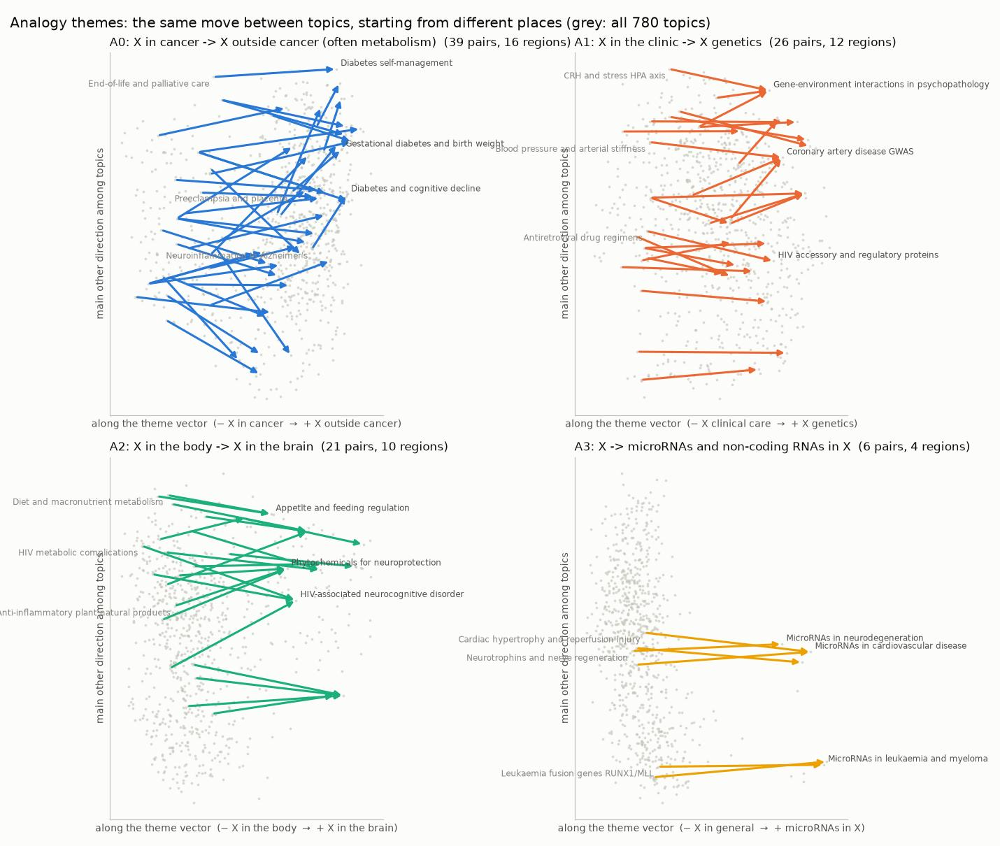
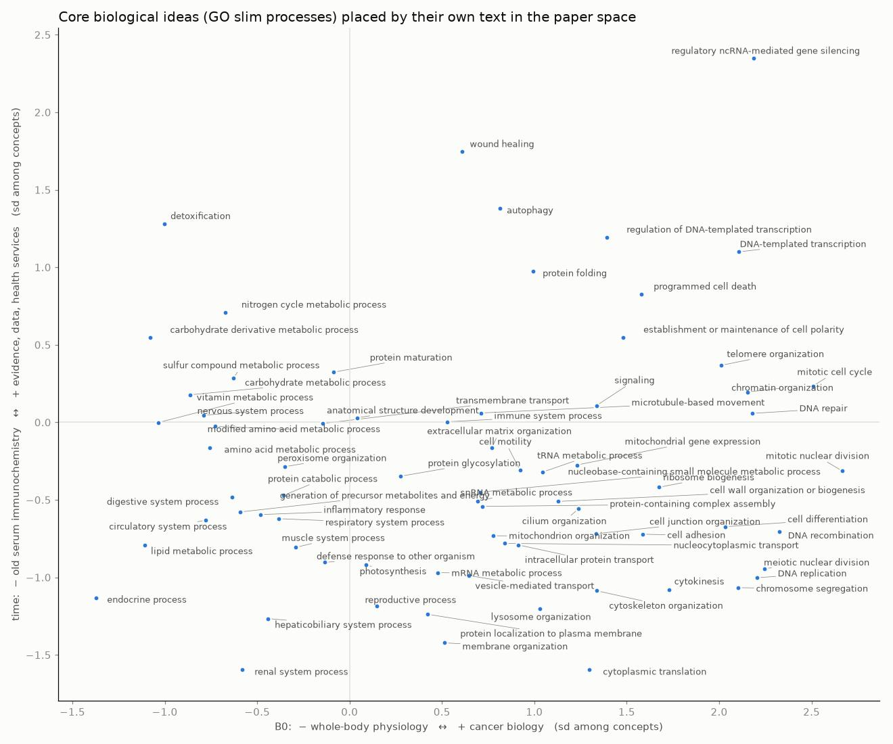
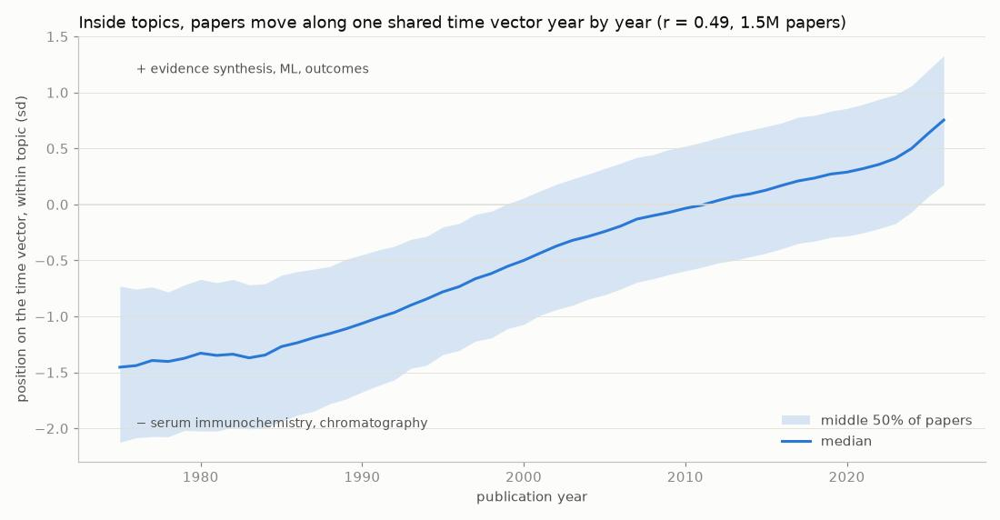

# The space of biological ideas: themes, concepts, time and a map to walk it

Started 2026-11-04 (branch `geometry-manifold`). Data: the 7.76M human-gene papers and their MedEmbed-small
vectors from `geometry/` (384 numbers per paper, unit length), and the 780 topics (clusters) of
`cluster_sweep.py --assign eom_mcs200_ms3`.

The plan was: topics → centroids → vectors between centroids ("between-topic vectors") → cluster those vectors to
find the themes behind the topics → put core concepts next to the papers as coordinates → use time vectors to
predict where the literature goes (inspired by ForeSCITE, below) → navigate.

**Explorer:** <http://outsee4.lan:8768/> (`explorer.py`). Type an idea, see where it lands, walk it along any axis,
complete an analogy, route between topics, or list topic pairs that run along a direction.

## At a glance

| # | Question | Answer | Against |
|---|---|---|---|
| 1 | Is the space centred? | No: the mean paper vector has length 0.79. Every paper shares one big direction; everything below works on vectors minus that mean | 0 for a centred space |
| 1b | Does centring help, and can papers be clustered straight in 384-D (cosine HDBSCAN)? | Centring changes 17% of nearest neighbours but makes them slightly worse by MeSH, genes and journal field; it barely changes a gene's Map view. HDBSCAN straight on the 384-D vectors (raw or centred) gives one giant cluster, or leaves 93-97% of papers out | Raw cosine; HDBSCAN on 12-D UMAP (780 topics, 53% of papers clustered) |
| 2 | Do between-topic vectors, clustered directly, give themes? | Only one coarse one: a loose blob of 3,107 of 5,355 edges (coherence 0.18) along hospital care ↔ basic science, 5 small local clusters (15-22 edges) and noise. Its axis is the main direction of all the steps (cos 0.99), which PCA gives without clustering. As pairs it reads "same subject, bedside → bench" (sleep and health → circadian clock genes) | A Gaussian null with the same spread has an equally strong main step direction (5.2% of step variance against 4.8%), but along the map's first axis B0, and HDBSCAN finds 36 small clusters and no blob: the strength comes from the spread, the bedside ↔ bench direction from the real data |
| 3 | Do between-topic vectors repeat across the map? | Yes: 10.9% of edges have a partner elsewhere on the map with \|cos\| > 0.6 | null: 0.0% |
| 4 | Analogy themes, calibrated so the null gives none | 22 themes; the top three: **"X in cancer → X"** (39 edges, 16 regions), **"X in the clinic → X genetics"** (26, 12), **"X in the body → X in the brain"** (21, 10) | Largest \|cos\| in 5 null draws: 0.593 |
| 5 | Do the analogy vectors work on topics that did not define them? | Yes: "X → X in cancer" applied to the 710 other topics lands on topics with +50 points more Neoplasms headings (z = 14; beats all 1,000 placebo steps) | Steps of the same length along real between-topic directions |
| 5b | At 3,349 finer topics | 34.6% of edges have a partner above the null's maximum; 182 themes; the largest read as a grammar of moves: change the level of explanation (clinic → genetics, disease → its microRNAs, target → drugs), the context (non-cancer → cancer, brain → body), or the organ (gut → lung, body → mouth). All 182 named: 164 real, and 92% of the 61 with 5+ pairs are one of those three kinds | Same null procedure |
| 5c | Does a dictionary learned from single papers agree? | Yes: a sparse autoencoder (4,096 features, 84% of variance) has single features within cos 0.80-0.92 of the cancer, brain and microRNA analogy vectors | |
| 6 | Themes behind the clusters: directions papers vary along *inside* topics | 6 axes have at least half their length inside the top-20 local directions of most topics (93%, 83%, 82%, 74%, 65%, 52%): gene mapping ↔ drug treatment; populations ↔ mechanism; bench biochemistry ↔ patient outcomes; immune cells ↔ drug design; … | A random direction has 5% (20/384) of its length there on average and essentially never half |
| 7 | Can concepts be placed by their text alone? | Yes: a MeSH concept's "name: definition" vector finds its own papers' centroid first among 22,142 in 60% of cases, top-10 in 88% | Chance: 1 in 22,142 |
| 8 | Is there a time vector? | Yes, one shared by topics: each topic's own drift (slope of its papers on year) agrees with the others' (mean pairwise cos 0.32); a paper's position on it correlates with its year at r = 0.49 (within topic) | 0 in 384-D |
| 9 | Does it predict where topics move? | Yes: chosen on 1999-2008, then fixed, it beats "nothing moves" for 2021-23 in 91% of 749 topics (squared error 0.86x); 68% (0.97x) when the target is rebuilt without the clustering | Persistence |
| 10 | Does it predict which topics grow? | No: position on the time vector adds R² 0.006 to past growth | |
| 11 | Does geometry predict new gene-disease links? | Yes: among pairs never co-mentioned up to 2015, closeness adds to popularity and common neighbours (AUC 0.934 → 0.953, average precision 0.152 → 0.169), though it lowers precision of the top 1,000 (0.636 → 0.578); moving genes and diseases along their own time vectors restores that and adds a little average precision (0.173) | The two graph baselines |
| 12 | ForeSCITE's move: shift a topic's papers along its time vector | Right direction, small effect: at the topic's own past rate over the real 8-year gap, the shift brings 68% of 776 topics closer to the real 2019-23 papers (another topic's vector 41%, backwards 1%, random 1%); a quarter of that step: 90% (79%, 3%, 22%). Gains are about +0.001 cosine | The same steps in placebo directions |
| 13 | Does a topic's time vector say which MeSH headings rise in it? | A little: median Spearman 0.08 with the actual change (positive in 71% of topics), 0.07 beyond what trend extrapolation predicts (trend alone: 0.13) | Trend extrapolation |
| 14 | Is it MedEmbed only? | No: in Qwen3-Embedding-8B (best embedder on BioScore, 4,096-D) the same analogy pairs are as parallel (z 17/13/14 vs MedEmbed 15/11/14), the time vector is stronger (year r 0.65 vs 0.49) and concepts are placed better (66% vs 57% top-1); 100 papers per topic | The same 78k papers in MedEmbed |

## 1. The papers sit in a narrow cone

The mean of all 7.76M paper vectors has length 0.79 (1 would mean every paper identical); a topic's centroid
has length 0.86 (median). So most of every vector is the shared "this is a biomedical abstract" direction, and
cosine similarity between any two papers is high. Differences between centroids cancel it; kNN graphs and
concept placement do not, so the geometry below subtracts the mean first (`centroids.py`; the one exception is
picking each topic's central papers for naming, `topic_inputs.py`, which ranks by raw cosine).

**Centring changes the neighbours, but does not improve them** (1M papers, 5,000 queries): two random papers have
raw cosine 0.62 (sd 0.056), centred 0.00 (sd 0.10); a paper's nearest neighbour stands 4.8 random-pair sds above
random raw, 6.9 centred; and only 80% of the 15 (79% of the 100) nearest neighbours are the same under the two. Over
all 7.76M papers (`centre_nn.py`: truth.py's 20,000 queries, exact 15 nearest by raw and by centred cosine) 83%
are the same, and the centred ones are slightly worse by everything the vectors never saw: they share an
informative MeSH heading with the query 77.7% of the time against 77.9% raw (−0.19 ± 0.05 points), a gene 60.8%
against 61.0%, a journal field 19.2% against 19.6%; among only the neighbours that differ, −0.8, −1.0 and −2.1
points. So centring sharpens the contrast between near and random papers without finding better neighbours; there
is no case for it in cosine kNN or kNN-based clustering of these vectors (an earlier version of this section said
the opposite). Directions, axes and concept placement below still use centred vectors: there it is the shared
offset, not the neighbour order, that matters.

**HDBSCAN straight on the 384 numbers does not work** (`../hdbscan_384.py`, cuML on a GPU). cuML's HDBSCAN is
Euclidean only, but on unit vectors Euclidean² = 2 − 2 cos, so the tree is the cosine tree; centred cosine is the
same after subtracting the mean and rescaling. On the 1M-paper sample that the 780 topics were fitted on (scores as
`cluster_sweep.py`: gene lift = P(share a gene | same cluster) / P(share a gene | any two clustered papers)):

| Clustering of the same 1M papers | Clusters | Papers in a cluster | Gene lift | Journal field lift | Agreement with the 780 topics (ARI) |
|---|---|---|---|---|---|
| 12-D UMAP, then HDBSCAN eom, min cluster 200 (the 780 topics) | 780 | 53% | 10.3 | 5.2 | |
| 384-D, eom, any of 4 settings, raw or centred | 2 | one cluster of 54-100%, or 13-27% | 0.95-1.05 | 1.0 | 0.00 |
| 384-D, leaf, min cluster 200: raw / centred | 76 / 91 | 3.0% / 4.0% | 13.1 / 12.9 | 3.6 / 4.5 | 0.50 / 0.58 |
| 384-D, leaf, min cluster 50: raw / centred | 575 / 606 | 5.6% / 6.5% | 23.1 / 25.4 | 5.0 / 5.8 | 0.54 / 0.53 |

In 384-D, eom selection always returns one giant cluster and noise; leaf selection finds only the densest cores
(very pure, and they agree with the UMAP topics), and leaves 93-97% of papers out. At 100k papers it is the same
(80-99% noise, or one cluster of 79%). So density clustering needs the dimension reduction first (the intrinsic dimension is about 14,
geometry/README). Centring helps the 384-D leaf clustering a little (more clusters and papers, higher field lift),
the opposite of its effect on nearest neighbours, but not enough to matter. A cosine option in cuML's HDBSCAN would
change nothing here: unit length plus Euclidean already is cosine, as cuML's maintainers say in
https://github.com/NVIDIA/cuml/issues/6123.

**Inside one gene's map it barely matters either** (`mapcentre.py`). The genesearch Map view's steps (cosine
neighbours, UMAP to 12-D, up to 8 HDBSCAN topics, UMAP to 2-D) on the PubTator-tagged papers of 15 genes, 4,203 to
65,282 per map (the live Map view also adds Open Targets curated and Europe PMC text-mined papers, so its maps of these
genes are 5-34% bigger), run on raw vectors, vectors minus the corpus mean, and vectors minus the map's own mean,
scored by MeSH headings the vectors never saw (headings on 2+ and at most 10% of the map's papers). Counting only
papers that carry such a heading (63-81% of each map), as the paper and as its neighbours: of each such paper's 15
nearest such papers on the 2-D picture, 0.643 share a heading with it raw; 0.650 corpus-centred and 0.652 map-centred (higher in 14 of 15 maps;
a second raw run moves it by 0.000 ± 0.003). Nothing else moves: the 12-D and 384-D neighbours (±0.002), topic
quality (P(share a heading | same topic) / P(share | any two): 1.90 raw, 1.87-1.90 centred) and the number of topics.
A gain of 1% on the picture is not worth changing the Map view for.

Centred, the 780 topic centroids spread in many directions: the first principal axis holds 10.6% of their
variance, 45 axes hold 80%, participation ratio 27.

## 2. Topics with names

`topic_inputs.py` collects per topic the MeSH headings most over-represented in it (from the PubMed XML,
`parse_mesh.py`: 7.55M of the papers found, 81% with MeSH, median 13 headings among those), its genes, journal field, median
year and the titles of its 8 most central papers. 20 agents named the 780 topics from that (a name, a line, a
kind, and a flag if it lumps unrelated things): `<name>_labels.csv`. 12 are flagged mixed, e.g. "Journal
corrigenda", "Letters, replies and journal history", and topic 125, named "retracted lncRNA/miRNA cancer
papers". It is the most retraction-heavy topic (13.6% of its papers are flagged Retracted Publication, 65x the
corpus rate of 0.21%), but most retracted papers are elsewhere: neighbouring ncRNA-cancer topics hold more of them
("Cancer microRNA targeting networks" 1,217, "Cancer lncRNAs and ceRNA networks" 1,008, topic 125 413 of 15,680).

## 3. Between-topic vectors and analogy themes

**Clustering them directly finds one coarse axis, nothing finer.** `directions.py` links each topic to its 10 nearest, takes the unit
difference of the two centroids per edge, and clusters the 5,355 edges with HDBSCAN on 1 − |cos| (an edge has no
direction, so v and −v are one axis). In 384-D one loose cluster (coherence 0.18) takes 3,107 edges: surgery,
cardiology, nursing ↔ nuclear transport, splicing, cell cycle; 5 small local clusters take 15-22 edges each
(coherence 0.48-0.72) and the other 2,154 edges are noise. The blob's axis is just the main direction of all 5,355
steps (cos 0.99; that one direction carries 4.8% of the steps' variance, a random one 0.26%), so PCA of the steps
finds it without any clustering. It lies close to the centroids' second principal axis B1 (cos 0.73; the first, B0,
0.55), the clinic → genetics analogy theme A1 (0.78) and the within-topic axis W1 (0.75): one bedside ↔ bench
contrast, seen between neighbours, across the map and inside topics. Read as pairs it is "the same subject, bedside
→ bench": sleep duration and health → circadian clock genes, intravenous iron therapy → transferrin and iron
regulation, antiretroviral regimens → HIV accessory proteins (explorer: axis S0, Pairs tab). Centroids drawn from a
Gaussian with the same covariance have an equally strong main step direction (5.2% of step variance against 4.8%),
and there HDBSCAN finds 36 small clusters (largest 112 edges, coherence 0.40-0.78) and no blob. But the Gaussian's
main step direction is the centroids' first principal axis B0 (82-97% of it on B0 in 6 draws; cos 0.52-0.76 with
the real one), not bedside ↔ bench: real neighbours differ less along B0 than Gaussian ones (3.9% of step variance
against 4.7-5.8%) and more along S0 (4.8% against 4.4-4.6%). So the strength of the main direction comes from the
spread, and its tilt toward bedside ↔ bench from the real data. Clustering found nothing that PCA of the steps
does not give, the 5 small real clusters are no tighter than the null's, and the blob swallows everything finer.
Whitening the top axes does not rescue it: on 64 whitened axes one blob again (3,238 edges, plus one of 31; the null
gives one half that size), on 32, 17 small local clusters (largest 53 edges; 4,342 of the 4,786 edges are noise).

**But the vectors do repeat.** Allow two edges to vouch for each other only if they share no topic and no
endpoint region (20 k-means regions of the map), and use mutual neighbours only (no hub topics). Then 10.9% of
the 2,445 edges have a partner elsewhere with |cos| > 0.6; in the null, none do (`relations.py`).

**Analogy themes** (`analogies.py`). Threshold = the largest |cos| between any allowed pair of edges in 5 null
draws (0.593), so in the null not one pair passes. Themes = groups of edges linked above it (loose groups are
split by raising the bar inside them). 22 themes with 3 or more edges. Named by agents from both lines of evidence
below, with a skeptic checking each name (`<name>_axes_named.json`):

| Theme | Edges / regions | The relation | Examples (− topic → + topic) |
|---|---|---|---|
| A0 | 39 / 16 | X in cancer → X outside cancer | Metformin as anticancer agent → Metformin mechanisms; Thyroid cancer → Thyroid hormones and Graves; IGF system in cancer → IGF binding proteins; COX-2 in cancer → Leukotrienes |
| A1 | 26 / 12 | X in the clinic → X genetics | IBD biologic therapy → IBD immunology and genetics; TB diagnosis → TB immune response; Psoriasis biologics → Psoriasis immunopathology; Severe asthma management → Asthma and allergy genetics |
| A2 | 21 / 10 | X in the body → X in the brain | Alcoholic liver disease → Alcohol effects on brain; Exercise and rehab in cancer → Exercise, cognition and BDNF; Menopausal hormone therapy → Brain estrogen |
| A3 | 6 / 4 | X → microRNAs in X | Leukaemia fusion genes → MicroRNAs in leukaemia; Glioblastoma signatures → MicroRNAs in glioma |
| A7 | 5 / 4 | X in heart and vessels → X in kidney | Creatine kinase and rhabdomyolysis → NGAL acute kidney injury; Blood pressure → Chronic kidney disease |
| A14 | 3 / 5 | X under injury → X regeneration | Cardiac reperfusion injury → Cardiac regeneration; Cerebral ischaemia → Nerve regeneration |
| A20 | 3 / 4 | Drug treatment of X → immune biology of X | Tacrolimus dosing → Transplant rejection; Antiretroviral regimens → HIV pathogenesis |

Directions are not kept by 2-D maps (t-SNE keeps neighbourhoods), so each theme is drawn in a projection of the
384-D space: across, the theme vector; up, the main remaining direction among topics.

**Do they work?** Two checks.
- *Completion* (leave one edge out): start at the edge's first topic, add the theme vector built from its other
  edges, and the true partner is the nearest topic 76% of the time (top-5: 97.5%), against 17% (63%) for the start
  topic's own nearest neighbour and 72% top-5 for a step of the same length along another theme's vector. This is
  partly by construction (edges were picked for being parallel).
- *Held out* (`analogy_check.py`), the real test: apply the vector to every topic that did not define it, land on the
  nearest topic, and compare its MeSH branches with the start's. Placebo: 1,000 steps of the same length along real
  between-topic directions (other edges of the topic graph, random sign). (Random directions in 384-D are a far
  weaker placebo: most land back on the start topic's own neighbour, which inflates z about five-fold, four- to
  ten-fold by theme; a first version used them.)

Over the 710 topics outside A0, 738 outside A1, 748 outside A2 (change in the landing topic's share of papers under
a MeSH branch, percentage points; z against the placebo; every shift in bold beats at least 998 of the 1,000
placebo steps):

| Theme | Step toward + : landing topic has more | Step toward − : more |
|---|---|---|
| A0 X in cancer → X | (weak: sugars, hormones; z 2, beats 97-99%) | **Neoplasms +50 points (z 14)** |
| A1 clinic → genetics | **Genetic phenomena +22, genetic structures +13 (z 5)** | **Therapeutics +12, drug therapy +6, patient care (z 5)** |
| A2 body → brain | **Central nervous system +28, neurons +18 (z 20)** | |
| A3 → microRNAs | **Antisense elements +51, nucleic acids +53 (z 30-80)** | |
| A7 heart → kidney | **Urologic diseases +12 (z 11)** | Heart diseases +4 (z 4, beats 99%) |

Where placebo steps barely move a branch (rare branches such as antisense elements), the placebo spread is tiny and z
is unstable: over five draws of 1,000 placebo steps (`--seed`), A3's antisense z ranges 20-83 and nucleic acids
17-30, against A0 12-14, A1 4.4-4.6, A2 18-22 and A7 11-14. The share of placebo steps beaten does not move. (With
200 placebo steps, as in the finer-topic table below, z is noisier still: A2 14-34 over three draws.) (An earlier version of this table came from an older run of the script; this
one is from the committed code, `--random 1000`.)

**Finer topics, more themes.** On the 3,349 finer topics (named from their top MeSH headings, `mesh_labels.py`),
9,539 mutual edges, null threshold 0.540: 34.6% of edges have a partner above it, 182 themes with 3+ edges.
The 20 largest, named and checked by agents from their pairs and held-out MeSH shifts
(`eom_mcs50_ms3_themes_named.json`; one, dopamine → serotonin, rejected as a local axis), read as a grammar with
three kinds of move (the full held-out check, `analogy_check.py eom_mcs50_ms3 --themes 182 --no-iso`):

| Kind of move | Themes (topic pairs; held-out z of the main MeSH shift, against 200 real between-topic steps; every shift quoted beats at least 99% of them) |
|---|---|
| **Change the level of explanation** | clinical care → genetics (82; genetic phenomena +18 points, z 5; backwards clinical protocols, drug therapy z 6-7); disease → its microRNA studies (58; antisense elements +50 points, z 50); genetic association → cell or tissue mechanism (32; backwards genotype z 15); immune → intrinsic cell biology (20; backwards z 8); drug target → medicinal chemistry (19; drug development z 26) |
| **Change the context** | non-cancer → cancer (53; neoplasms +35 points, z 14); brain → whole body (49; backwards neurocognitive z 50); cardiovascular → metabolic (38; backwards heart z 14, forward sugars and nutrition only z 4); substance use → other disorders (23; backwards chemically induced disorders z 20); kidney disease → general (20; backwards urologic z 26); pregnancy and newborn → general (17; backwards reproductive phenomena z 39, embryonic structures z 32); stem cells → native tissue (14; backwards stem cells z 30); animals and ecosystems → human toxicology (14; backwards ecological z 18) |
| **Change the organ** | gut → lung (20; lung z 16, backwards GI z 14); body → mouth and jaw (18; dentistry z 48); pancreas → stomach and colon (16; backwards pancreatic diseases z 27, forward weak); cancer → glioma (15; nervous system neoplasms z 61); prostate → other cancers (15; backwards urogenital neoplasms z 35); GI cancer → breast cancer (12; weak: forward skin z 5, backwards GI z 10) |

**All 182, named.** The other 162 themes were named the same way (an agent per batch of 18, a skeptic checking each
name; MeSH evidence only), and each of the 182 was sorted into one of the three kinds or "other" by a rubric written
from the 20 above. 164 are real repeated relations (18 rejected: 16 hub stars, where one topic or one narrow subject
sits at the same end of most pairs; one set of near-duplicate topics; one local block between two neighbouring
clusters), 159 of them with medium or high confidence (107 high). How they sort:

| Themes (medium/high confidence) | Level of explanation | Context | Organ | Other |
|---|---|---|---|---|
| with 5+ topic pairs (61) | 25% | 30% | 38% | 8% |
| all (159) | 31% | 18% | 30% | 21% |

The three kinds hold for the larger themes, also those that did not shape the rubric (37 of the 42 with 5+ pairs
beyond the first 20, 88%). "Other" grows among the 3- and 4-pair themes, and about a third of its 33 are one further
move: keep the subject and swap the molecular pathway or player (Notch → Wnt, thrombin → plasmin, chromatin →
splicing, long non-coding RNA → microRNA, signalling → oxidative stress), mostly 3-pair themes; three swap the
organism (plants, fungi, microbes), four the lifestyle or nutrient (exercise, diet, vitamin D), and the rest are one
or two each. Caveat: the rubric came from the first 20, and one agent plus one skeptic sorted each batch. New ones
include cervical and genital-tract cancer → head, neck and mouth cancer (often HPV), allergic asthma → smoke- and
dust-induced lung disease, X without ischaemia → X in stroke and myocardial ischaemia, X in general → X in HIV/AIDS,
before conception → pregnancy, skin → gut, bone → cartilage, eye → elsewhere in the body (often the nervous system),
skeletal muscle → heart, cholesterol biology → statin treatment. All 159 are walkable in the
explorer (axes F*), and `theme_evidence.py` writes the evidence the agents saw.

**A learned dictionary agrees** (`sae.py`). A top-k sparse autoencoder on the centred paper vectors (4,096
features, 32 active per paper, trained on 2.9M papers capped at 4,000 per topic; no topics, no MeSH) explains 84%
of held-out variance; every feature fires (median on 0.33% of papers), and 99% have a MeSH heading at 5x lift or more where they
fire, most reading as one idea (dopamine and striatum; multiple sclerosis and EAE; postmenopausal hormone therapy; topoisomerase II
poisons; BNP and heart failure; pre-eclampsia; islet transplantation; …; `sae/features.csv`). The analogy vectors,
built from pairs of topic centroids, are close to single features: "X in cancer → X" to the tumour cell-line
feature (cos −0.92), "→ brain" to the brain / neurons / Alzheimer feature (0.89), "→ microRNAs" to the microRNA
feature (0.80); "clinic → genetics" is mutation / genotype (+0.63) against treatment outcome / RCT (−0.56), the same
pair as the within-topic axis W0 (+0.62 / −0.72): one contrast, seen between topics and inside them.

## 4. The themes behind the clusters: axes inside every topic

`axes.py` takes, for each topic, its papers' scatter around the centroid, scales each topic to equal weight, and
averages: W. W's top directions are the ways papers differ *inside* topics, shared across topics. For most topics
at least half of each lies in that topic's own top-20 directions: W0 93% of topics, W1 83%, W2 82%, W3 74%,
W4 65%, W5 52% (a random direction has 5% of its length there on average and essentially never half). W is an
average over these same topics, so this could be partly circular; rebuilding W without each topic in turn gives
the same shares (92, 83, 81, 74, 64, 52%). `label_axes.py` reads them off the papers' MeSH headings and publication types (effect = how far
toward + the papers with a heading sit, in sd), and `concept_axes.py` independently from where MeSH and GO concept
*texts* fall on them. The two agree:

| Axis | − end | + end | MeSH at the ends (papers) | Concepts at the ends (text) |
|---|---|---|---|---|
| W0 | Drug dosing and administration | Gene mapping and heredity | Ranibizumab, phase I trials ↔ LOD score, linkage, QTL, twin study | IV anaesthetics, analgesia ↔ genetic loci, linkage, X-linked genes |
| W1 | Population and clinical description | Molecular mechanism | Seroepidemiology, outbreaks, prevalence ↔ viral polymerase, allostery, MD simulation | Symptoms, medical records ↔ protein binding, mTORC2, ubiquitin ligase binding |
| W2 | Bench biochemistry | Patient outcome statistics | Chromatography, ultracentrifugation ↔ Mendelian randomisation, mortality, propensity scores | Electron and cryo-EM microscopy ↔ cancer survivors, risk adjustment, propensity score |
| W3 | Immune (myeloid) cells | Computational drug chemistry | Macrophages, neutrophil infiltration ↔ QSAR, docking, pharmacogenetics | Histiocytes, dendritic cells ↔ pharmacogenomic testing, drug repositioning, docking |
| time | Serum immunochemistry | Evidence synthesis and data | Immunoelectrophoresis, immunodiffusion ↔ network meta-analysis, machine learning, deep learning | Serologic tests, serum globulins ↔ precision medicine, implementation science |

W and the between-topic axes B share a lot (top-20 subspace overlap 0.72, chance 0.05): the directions that
separate topics also run through them. The B axes are the map's regions (B0 autonomic physiology ↔ cancer biology,
B1 hospital care ↔ basic science in model organisms, …): all 47 axes with names, poles and confidence are in
`eom_mcs200_ms3_axes_named.json`; the skeptic marked 7 low confidence (W4, W7 and the small analogy themes A4, A12,
A13, A15, A17).

## 5. Concepts as coordinates

`concepts.py` embeds every MeSH descriptor (31,110) and GO term (40,214) with MedEmbed-small, by name and as
"name: definition". MeSH concepts also get a ground-truth position: the centroid of the papers indexed with them
(22,142 with 50+ papers). Does the text land on its own papers?

| Concept text | Own centroid first (of 22,142) | Top 10 | Median rank |
|---|---|---|---|
| name | 57% | 83% | 0 |
| name, centred | 58% | 84% | 0 |
| name: definition | 56% | 87% | 0 |
| **name: definition, centred** | **60%** | **88%** | 0 |
| learned linear map, text → centroid | 41% | 77% | 1 |

So a concept can be placed among the papers from its text alone, centred by the concept mean; that is how the
explorer places typed text. On the time axis, a concept's text coordinate predicts the median year of its
papers (Spearman 0.32, 22,142 concepts; `concept_year.py`). Other single axes come close (analogy theme A12 0.31,
W1 0.26), and a ridge regression on all 384 centred dimensions (5-fold cross-validated) reaches 0.38. Against the
year NLM introduced the heading it is weaker (0.17; A10 and W1 do better, about 0.3), but recent headings do sit
toward "new": 2010s +0.77 sd, 2020s +0.73 sd, against −0.10 to +0.20 for the 1970s-2000s.

**Coordinates of core ideas** (`core_map.py`): the 72 GO slim biological processes placed by their own text on two
named axes. Cell and cancer biology (cell cycle, DNA replication and repair, chromosome segregation, transcription)
sit right, whole-body physiology (endocrine, renal, circulatory, digestive, lipid metabolism) left. Newer-style
research sits high (ncRNA gene silencing +2.3 sd, wound healing, autophagy, programmed cell death, protein folding),
older-style low (renal physiology, cytoplasmic translation, membrane and lysosome organisation). All 141 GO slim
terms on the main axes: `<name>_core_concepts.csv`.

## 6. Time vectors

The inspiration Dan remembered is most likely **ForeSCITE** (Chang, Ondov, …, Hua Xu, "Learning Scientific
Trajectories to Predict Future Biomedical Discoveries", arXiv 2610.38719, 28 Oct 2026): it clusters ~3M biomedical
conclusions into 407 topics, finds in each a direction from earlier to later findings, shifts embeddings along it
and decodes them into hypotheses. Two other candidates: Nylund, Gururangan & Smith 2024 (the "time vectors" name,
in model weights, https://arxiv.org/abs/2312.13401) and Tshitoyan et al. 2019 (embeddings of older abstracts flag
later discoveries, https://www.nature.com/articles/s41586-019-1335-8).

**Topics share one time direction.** Each topic's time vector (least-squares slope of its papers on year) points
the same way as the others' (mean pairwise cos 0.32 over 780 topics; the mean of the unit vectors has length 0.56).
44% of it lies on within-topic axis W2 (bench ↔ outcomes).

The median paper is nearly flat until the mid-1980s (−1.45 sd in 1975, −1.34 in 1984), then climbs steadily to
+0.75 sd (2026), steeper after 2022.

**Forecasting topic positions** (`timevec.py drift`). Train 2009-2018, predict the 2021-23 centroid, error relative
to "the topic stays where it was in 2016-18":

| Prediction | Squared error vs persistence (median) | Topics improved |
|---|---|---|
| own slope | 1.19 | 33% |
| shared time vector | 0.91 | 87% |
| own and shared, half each | 0.87 | 69% |
| **chosen on 1999-2008 → 2011-13, then fixed: 0.2 own + 0.8 shared, 0.75 of the step** | **0.86** | **91%** |
| the same, target rebuilt without the clustering (2021-23 papers to the nearest 2016-18 centroid) | 0.97 | 68% |

A topic's own slopes are noisy; shrunk toward the shared one they help. The clustering saw all years, which could
flatter the first target; the rebuilt target is biased the other way (nearest *old* centroid), so the truth lies
between. A topic's own past direction does point where it goes next: cos with the actual move 0.36, against 0.12
for another topic's slope.

**Growth** (`timevec.py growth`): topics at the "new" end grow faster (Spearman 0.50 with 2019-23 growth), but past
growth already says that (0.80); adding position raises R² from 0.500 to 0.506. Nothing.

**Latent knowledge: new gene-disease links** (`timevec.py links`; Tshitoyan's test on paper embeddings). Pairs of
a PubTator gene (10+ papers) and a MeSH disease heading (100+ papers) never in one paper up to the cutoff; positive
if 3+ papers co-mention them in the horizon. Gene and disease positions are centroids of their papers up to the
cutoff; "time" moves each along its own slope to the middle of the horizon.

| Score | 2010 → 2011-15: AUC | within popularity deciles | 2015 → 2016-23: AUC | within deciles |
|---|---|---|---|---|
| popularity (log papers, gene + disease) | 0.925 | 0.571 | 0.920 | 0.578 |
| common neighbours | 0.925 | 0.684 | 0.896 | 0.712 |
| cosine | 0.718 | 0.831 | 0.670 | 0.802 |
| cosine after the time-vector shift | 0.771 | 0.831 | 0.723 | 0.790 |

30.5M (2010) and 46.7M (2015) unlinked pairs; 0.23% and 0.53% became linked. Fitted on 2010, tested on 2015:

| Logistic model | AUC | Average precision | Precision of the top 1,000 |
|---|---|---|---|
| popularity + common neighbours | 0.934 | 0.152 | 0.636 |
| + cosine | 0.953 | 0.169 | 0.578 |
| + cosine after the time shift | 0.952 | 0.172 | 0.636 |
| + both | **0.953** | **0.173** | 0.636 |

Closeness is the strongest signal once popularity is held fixed, and it adds to both graph baselines. The time shift
is a modest extra: as a single score it raises overall AUC (popular genes drift toward popular diseases), but within
popularity deciles it does not help in 2015; in the combined model it mainly repairs the top of the ranking. All
positions are centred with the mean of papers up to the cutoff (an all-years mean leans along the time vector; the
first version used it and scored slightly lower). Caveat: MedEmbed-small was trained after 2015 and may have read
some of the future.

**ForeSCITE's move, in embedding space** (`foresee.py`). Built from papers up to 2015, except that the topic seeds
come from the all-years clustering: centre with the pre-2016 mean, take each topic's pre-2016 centroid, give every
paper (1975-2023) to its nearest such centroid, refit each topic's time vector on its papers up to 2015, then shift
its 2011-15 papers along it and measure how close the real 2019-23 papers come to the shifted cloud. Step 1 = the
topic's own past rate carried over the real gap (2013 → 2021). Share of 776 topics whose future papers get closer:

| Step | Own time vector | Another topic's | Backwards | Random direction |
|---|---|---|---|---|
| 0.25 | **90%** | 79% | 3% | 22% |
| 0.5 | **86%** | 69% | 2% | 7% |
| 1 | **68%** | 41% | 1% | 1% |
| 1.5 | 48% | 21% | 1% | 0% |

Another topic's vector does well because the time direction is largely shared; the topic's own does better at every
step, so it also carries topic-specific direction. The gains are small (at most +0.001 in best-match cosine), and
the full past rate already overshoots a little. **Decoding** the shift as "which MeSH headings will rise in this
topic" (cos of the time vector with each heading's concept vector, against the change from 2011-15 to 2019-23 under
the same assignment): median Spearman 0.08, positive in 71% of 742 topics; 0.07 beyond trend extrapolation (which
alone gives 0.13). A weak but real signal. (A first version mixed two assignment rules and gave ~0; a review caught
it.)

## 7. The explorer

<http://outsee4.lan:8768/>: `atlas.py` bundles a 1.5M-paper sample (vectors, t-SNE positions, titles), the 780
named topics, 62k concepts and 207 axes (47 named by agents, S0, and the 159 finer analogy themes kept after
naming); `explorer.py` serves them (FastAPI). Everything is computed in
the centred 384-D space, never on the 2-D map; the map only shows where results are.
- **Locate**: text, a topic, a concept → nearest topics, concepts and papers, and coordinates on the main axes (in
  sd against concepts for text, against papers for topics).
- **Walk** a point along any axis; each step names the topic, concepts and papers it reaches and how close the
  nearest real paper still is (so leaving the literature shows).
- **Analogy**: a : b :: start : ?, with the start alone shown as the baseline.
- **Path**: shortest chain of neighbouring topics.
- **Pairs**: pick a direction and get diverse pairs of neighbouring topics whose step points along it (most parallel
  first, at most one pair per map region and each topic once; 20 regions, so long lists can stop at 13-14 and the
  page says so), drawn as arrows on the map coloured by the same
  direction. The default is S0, the main direction of neighbour steps (what clustering the steps directly found).
- **Ideas in this point**: the strongest of the sparse autoencoder's 4,096 features, named by MeSH. They compose:
  "ferroptosis in neurodegeneration" = ferroptosis / iron / ROS + brain / neurons + neurodegeneration + iron / ferritin;
  "gut microbiome and depression" = depression + gut microbiome + intestinal mucosa + brain.
- The 159 fine analogy themes kept after naming (F*) are walkable too: "Bone and cartilage tissue engineering" along body → mouth
  goes to Dental materials and endodontics, then Periodontitis.
- Colour the map by any axis (blue − end, red + end).

Examples: "insulin signalling" walked toward "X in cancer" goes Insulin receptor binding → Insulin signalling and
GLUT4 → IGF system in cancer → PI3K/AKT/mTOR in cancer. Thyroid cancer : Thyroid hormones :: Prostate cancer : SHBG
and circulating androgens (the start alone gives Androgen receptor in prostate cancer).

Run: `uv run --with fastapi --with uvicorn python geometry/manifold/explorer.py --port 8768` (about 1 minute to load).

## 8. Model check: is it MedEmbed only?

Qwen3-Embedding-8B (the best embedder on BioEmbed's BioScore, 0.662 against MedEmbed-base 0.592; 4,096 numbers per
paper) on 100 random papers per topic (78,000) and all 71,324 concept texts, on two GCP Spot L4s (about 100 minutes,
`gcp_embed.sh`; the VMs delete themselves). `modelcheck.py` measures both models on the same 78k papers, with the
topics and analogy pairs found in MedEmbed (so every Qwen number is an independent replication):

| | MedEmbed-small (384-D) | Qwen3-Embedding-8B (4,096-D) |
|---|---|---|
| Cone: length of the mean paper vector | 0.79 | 0.52 |
| Analogy themes' pairs, parallel against random topic pairs (z): A0 cancer, A1 clinic → genetics, A2 brain, A3 microRNAs | 15 / 11 / 14 / 9 | **17 / 13 / 14 / 10** |
| A0 backwards applied to the other topics: Neoplasms (z against steps along random topic pairs) | +26 points (z 6) | +22 points (z 7) |
| Time vector shared across topics (mean pairwise cos of per-topic slopes) | 0.17 | **0.28** |
| Within-topic position on it against year (r) | 0.49 | **0.65** |
| Concept text finds its own papers' centroid first / in top 10 (5,065 headings) | 57% / 87% | **66% / 92%** |
| Within-topic axes: share of topics where each of the top 6 lies mostly in its own top-20 directions | 69, 51, 33, 22, 11, 9% | 58, 24, 10, 2, 4, 0% |

The two spaces agree broadly (linear CKA 0.72) but not paper by paper (48% of the 10 nearest neighbours shared).
Their within-topic axes match when paired by papers' scores: MedEmbed's W0 (drug treatment ↔ gene mapping) with
Qwen's W2 at r 0.83, W1 (population ↔ mechanism) with Qwen's W1 at 0.71, W4, W5 and W2 at 0.58-0.66; W3 only 0.37.
(The within-topic shares are lower in Qwen because 20 directions are a much smaller part of 4,096 than of 384.)

**So the structure is not a MedEmbed quirk**: the analogy themes are as parallel in a model 230x larger, the time
vector is stronger, and concepts are placed better. 100 papers per topic give noisier centroids than the full data
(e.g. MedEmbed's own numbers above are lower than in sections 3-6), so compare across the columns, not with the
rest of the write-up. (5 of the 71,324 Qwen concept vectors came back NaN from fp16 on the GPU and are left out.)

## Running it

All CPU scripts use the repo root env (`uv run python geometry/manifold/<script>`), in this order:

| Script | Time | What |
|---|---|---|
| `centroids.py NAME...` | 30 s | year per paper, corpus mean, topic centroids overall and per year |
| `parse_mesh.py` | 8 min | MeSH descriptors; each paper's headings and publication types from the PubMed XML |
| `directions.py NAME` | s | between-topic vectors clustered directly (the failed first try) |
| `relations.py NAME [--mutual] [--null]` | 1 min | parallel partners and HDBSCAN themes, against the null |
| `axes.py NAME` | 3 min | within-topic axes W, between-topic axes B, per-topic time vectors |
| `label_axes.py NAME` | 4 min | MeSH and publication types at each end of each axis |
| `topic_inputs.py NAME` | 2 min | naming evidence per topic (MeSH lifts, central titles: local only) |
| `analogies.py NAME` | 1 min | null-calibrated analogy themes, completion test |
| `branches.py NAME`, `analogy_check.py NAME --themes 22 --random 1000` | 1 min, 1 min | MeSH branch shares per topic; held-out test of the themes |
| `concepts.py --embed --score` | 25 min (16 threads) | MeSH and GO concepts embedded; MeSH paper centroids; placement scores |
| `concept_axes.py NAME` | s | concept coordinates on every axis |
| `timevec.py drift / drift_reassigned / growth / links` | s / 1 min / s / 50 min | the time tests |
| `foresee.py` | 2 min | ForeSCITE-style shift test |
| `axis_evidence.py NAME` | s | evidence file the axis names came from |
| `mesh_labels.py eom_mcs50_ms3` | s | MeSH-only names for the 3,349 finer topics (after `topic_inputs.py`) |
| `analogy_check.py eom_mcs50_ms3 --themes 182 --no-iso`, `theme_evidence.py eom_mcs50_ms3` | 15 min, s | held-out test of all 182 finer themes; the evidence the naming agents read |
| `mapcentre.py [SYMBOL ...]` (genesearch env) | 10 min | does centring help the genesearch Map view? |
| `../hdbscan_384.py --data ~/medembed_small` (GPU, RAPIDS env next to `cluster_sweep.py`) | 20 min truth + 7 min per fit on an L4 | HDBSCAN straight on the 384-D vectors, raw vs centred; writes `eval/knn_centred.npy` |
| `centre_nn.py` (after `../hdbscan_384.py` has made `eval/knn_centred.npy`) | 2 min | are centred nearest neighbours better, or only different? |
| `sae.py` | 12 min (16 threads) | the sparse autoencoder and its feature names |
| `figures.py NAME` | 1 min | the two figures |
| `atlas.py NAME`, `explorer.py` | 3 min, 1 min | the explorer |
| `subset_texts.py NAME`, `gcp_embed.sh VM SHARD`, `gpu_embed.py`, `modelcheck.py` | ~1.5 h on two Spot L4s, 3 min | model check |

Outputs: `data/geometry/medembed_small/manifold/` (not in git). Topic and axis names were made by agents from MeSH,
gene and title evidence; the titles and abstracts themselves stay local.
